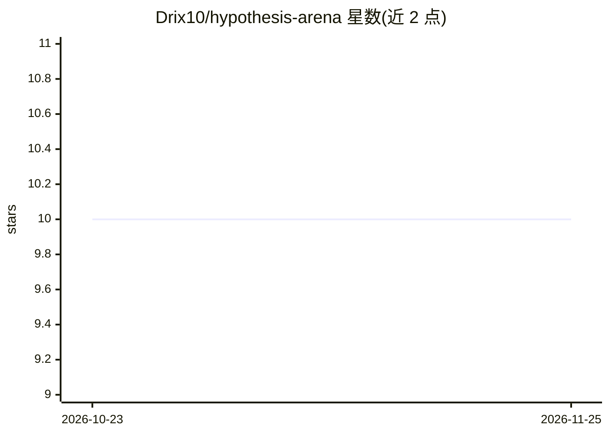

# Drix10/hypothesis-arena

⭐ 10 · Python · 推送 2026-10-14 · [GitHub](https://github.com/Drix10/hypothesis-arena) · [官网](https://www.mirohedge.com) · 个人维护

**交易关联公司新闻慢传导的AI辅助系统化基金（仅模拟盘）**

MiroHedge 是一个量化交易研究系统：利用一家公司的新闻对其供应商、客户、同行及共同持股企业价格传导滞后的现象，策略组合链接传播、财报文本变化与机会性内部人买入；LLM 只负责读取并输出类型化特征，C++17 内核独立完成仓位、风控、执行与退出。每笔回测先注册进哈希链账本，通过 deflated Sharpe、成本加倍测试与超额收益等门槛才可晋级。当前仅支持 paper trading，尚无策略通过门槛；Ubuntu 24.04/WSL 环境部署，未选择许可证。

## 筛选速览

| 维度 | 判定 | 备注 |
|---|---|---|
| AI 角色 | `ai-native` | 本体是模型或模型工具 |
| 许可风险 | `none` | — |
| 部署形态 | `library` | 以包/库形式分发 |
| 模型依赖 | — | README 未给出锁定关系 |
| 硬件要求 | — | 无带数字的原话,不猜 |
| 安装摩擦 | `low` | 无编译、无系统依赖或容器化 |
| 成熟度 | `idea` | |

## 能力要点

- Models read, code decides：模型输出仅作类型化特征，决策由确定性代码执行
- 预注册回测与哈希链试验账本，含 bootstrap 置信界、deflated Sharpe、过拟合概率等门槛
- HOLD 为默认状态，数据过期、规则破坏或证据冲突均触发
- C++ 内核含风控否决、下单路由、日志与 Alpaca paper 传输

## 适用场景

- 研究和验证利用关联公司间新闻传导滞后的量化策略
- 搭建仅用模拟盘的系统性交易流水线
- 学习模型读取与代码决策分离的交易系统架构

## 场景标签

`金融量化` · 领域:学习与行业

## 证据(README 行号)

> L3: **An AI-assisted systematic fund that trades the slow spread of news between linked firms.**
> L28: - **Models read, code decides.** A model never sizes, orders, vetoes or touches
> L48: |C++ kernel, order router, journal, Alpaca paper transport|built and tested; parked|

## 星数曲线

2026-10-23 10 → 2026-11-25 10（+0）

---
*卡片 v1 · prompt 1.4 · 生成 2026-11-20 · 置信度 high · 依据 README sha `7d49afe075fc` · [字段定义](../../DATASET.md)*
