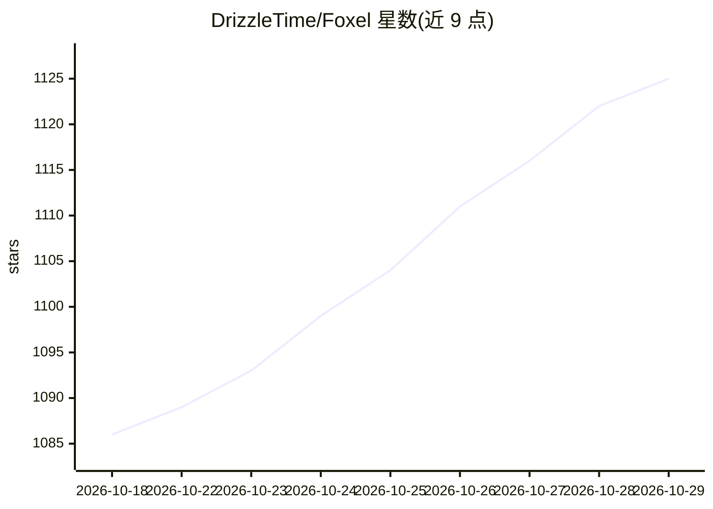

# DrizzleTime/Foxel

⭐ 1,125 · Python · MIT · 推送 2026-10-27 · [GitHub](https://github.com/DrizzleTime/Foxel) · [官网](https://foxel.cc) · 个人维护 · 中文 README

**面向个人与团队的可扩展私有云存储，含 AI 语义搜索与 Agent**

自托管私有云存储方案：通过适配器模式聚合本地存储、S3、WebDAV、网盘（百度/夸克/115 等）等 20 余种后端，统一界面浏览、上传、压缩解压、跨存储转移。内置 RBAC 权限（路径级规则、审计日志）、分享链接、插件系统、S3/WebDAV 协议映射。AI 部分提供语义搜索（可配置 embedding 与 Milvus/Qdrant 向量库）和内置 AI Agent（支持 OpenAI/Anthropic/Ollama 对话接口、工具调用审批机制、对外暴露 MCP 端点）。Docker Compose 部署，后端 Python 3.14+/FastAPI，前端 React 19，MIT 许可。

## 筛选速览

| 维度 | 判定 | 备注 |
|---|---|---|
| AI 角色 | `ai-enhanced` | 去掉 AI 部分产品仍成立 |
| 许可风险 | `permissive` | MIT |
| 部署形态 | `self-host` | docker 或自建部署 |
| 模型依赖 | local-ok | 支持本地模型 |
| 硬件要求 | — | 无带数字的原话,不猜 |
| 安装摩擦 | `low` | 无编译、无系统依赖或容器化 |
| 成熟度 | — | 结构信号不足 |

## 能力要点

- 适配器模式接入 20 余种存储后端并支持跨存储压缩/解压/转移
- 自然语言语义搜索，可配置 embedding 提供方与 Milvus/Qdrant 向量库
- 内置 AI Agent 与 MCP 端点，写操作经数据库审批批次执行
- 路径级 RBAC 权限规则（通配符/正则/优先级）与审计日志

## 适用场景

- 把分散在多个网盘与本地存储的文件集中到一个界面管理
- 用自然语言描述查找图片、文档等非结构化内容
- 自建带权限控制和分享链接的家庭或团队私有云

## 场景标签

`语义搜索` · 领域:知识与检索

## 证据(README 行号)

> L5: **A highly extensible private cloud storage solution for individuals and teams, featuring AI-powered semantic search
> L52: Go beyond filename matching — search by natural language descriptions to find content within images, documents, and
> L78: ### 🤖 AI Agent

## 星数曲线

2026-10-18 1,086 → 2026-10-29 1,125（+39）

---
*卡片 v1 · prompt 1.4 · 生成 2026-10-21 · 置信度 high · 依据 README sha `28c0f9cf7a11` · [字段定义](../../DATASET.md)*
