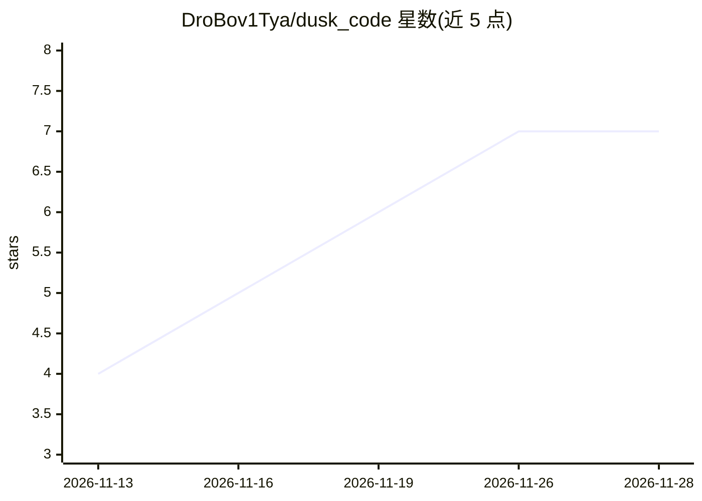

# DroBov1Tya/dusk_code

⭐ 7 · Rust · MIT · 推送 2026-11-27 · [GitHub](https://github.com/DroBov1Tya/dusk_code) · [官网](https://drobov1tya.github.io/dusk_code/) · 个人维护

**Rust 开源编程 agent：桌面/终端/浏览器多客户端**

以 Rust 编写的开源编码 agent，采用单一核心加薄客户端架构：桌面应用、终端 TUI 与浏览器客户端通过同一协议访问聊天线程。用户可接入 OpenAI、Anthropic、Google 或任何 OpenAI 兼容服务器（含 Ollama、LM Studio、vLLM 等本地运行时），也可用 ChatGPT 计划免 API key 登录。功能包括多种运行模式、子代理、审批机制、沙箱化插件商店、MCP 服务器、项目记忆、语音输入输出与 headless 模式。聊天记录以 SQLite 存于本地，无账户要求，默认关闭追踪。发布版覆盖 macOS arm64 与 Linux，无 Windows 构建。

## 筛选速览

| 维度 | 判定 | 备注 |
|---|---|---|
| AI 角色 | `ai-native` | 本体是模型或模型工具 |
| 许可风险 | `permissive` | MIT |
| 部署形态 | `None` |  |
| 模型依赖 | local-ok | 支持本地模型 |
| 硬件要求 | — | 无带数字的原话,不猜 |
| 安装摩擦 | `medium` | 含编译或系统依赖之一 |
| 成熟度 | `idea` | |

## 能力要点

- 一个核心驱动桌面、终端、浏览器三种客户端
- 支持 OpenAI/Anthropic/Google 及 OpenAI 兼容服务器与本地模型，可多 provider 同时接入
- 插件、技能、MCP 服务器在沙箱中运行，从签名商店一键安装
- ChatGPT 计划 PKCE 授权登录，无需 API key；对话默认本地 SQLite 存储

## 适用场景

- 在同一套聊天中用桌面/终端/浏览器操作项目里的编码任务
- 用本地模型离线处理代码，数据不出本机
- 通过子代理与审批机制委托多代理执行长任务
- 在服务器上通过 SSH 用终端客户端运行 agent

## 场景标签

`编码 Agent` · 领域:编码与开发

## 证据(README 行号)

> L3: An open-source coding agent in Rust. Open the same chats from the desktop app, terminal,
> L31: - **Choice of model.** OpenAI, Anthropic, Google, any OpenAI-compatible server,
> L90: - **Skills, MCP servers and plugins**: skills are loaded when a task needs them; MCP

## 星数曲线

2026-11-13 4 → 2026-11-28 7（+3）

---
*卡片 v1 · prompt 1.4 · 生成 2026-11-20 · 置信度 high · 依据 README sha `93e63df7df6f` · [字段定义](../../DATASET.md)*
