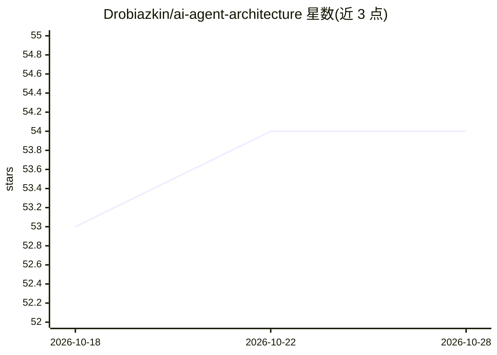

# Drobiazkin/ai-agent-architecture

⭐ 54 · HTML · CC-BY-SA-4.0 · 推送 2026-10-22 · [GitHub](https://github.com/Drobiazkin/ai-agent-architecture) · 个人维护 · 中文 README

**面向工程师的开源 LLM/Agent 系统架构书与配套课程**

一部免费开源的工程书籍（8 部分、26 章、5 附录、印刷版约 258 页），主题覆盖 tokenization、上下文工程、RAG 模式阶梯、agent 模式目录、MCP、评测与可观测性、微调与自托管部署等，以固定模式模板（Context/Problem/Solution/Mechanics 等）组织内容，并附九模块动手课程。面向已具备分布式系统设计经验、想把 LLM 与 agent 作为架构组件纳入工具箱的工程师。提供英文与俄文两版，Markdown 在 book/ 目录，HTML/PDF 需自行构建，图由 tools/figures/ 脚本生成。正文采用 CC BY-SA 4.0、代码 MIT 许可，通过加密货币地址接受捐赠。

## 筛选速览

| 维度 | 判定 | 备注 |
|---|---|---|
| AI 角色 | `ai-knowledge` | 知识聚合/清单类 |
| 许可风险 | `viral` | CC-BY-SA-4.0 |
| 部署形态 | `None` |  |
| 模型依赖 | — | README 未给出锁定关系 |
| 硬件要求 | — | 无带数字的原话,不猜 |
| 安装摩擦 | `low` | 无编译、无系统依赖或容器化 |
| 成熟度 | — | 结构信号不足 |

## 能力要点

- 26 章覆盖 tokenization 到自托管部署（LoRA/QLoRA、PagedAttention、量化、投机解码等）
- 以固定模式模板组织的模式语言写法，引用随文标注
- 九模块动手课程，从本地模型到 RAG、agent、MCP、评测、微调与毕业架构设计
- 英文与俄文双版本，图由脚本从公开数据生成并标注来源

## 适用场景

- 系统学习 LLM 与 agent 系统的架构模式与工程权衡
- 分布式系统工程师将 LLM/agent 纳入既有架构工具箱
- 跟随配套课程从零搭建含 RAG、评测与微调的完整系统

## 场景标签

`教程课程` · 领域:学习与行业

## 证据(README 行号)

> L12: Patterns, approaches, and engineering for enterprise automation — 8 parts, 26 chapters, 5 appendices, ~258 pages in
> L65: `course/` is a hands-on practicum that turns the book into a working system: nine modules from a local model on you

## 星数曲线

2026-10-18 53 → 2026-10-28 54（+1）

---
*卡片 v1 · prompt 1.4 · 生成 2026-10-24 · 置信度 high · 依据 README sha `7565282621b5` · [字段定义](../../DATASET.md)*
