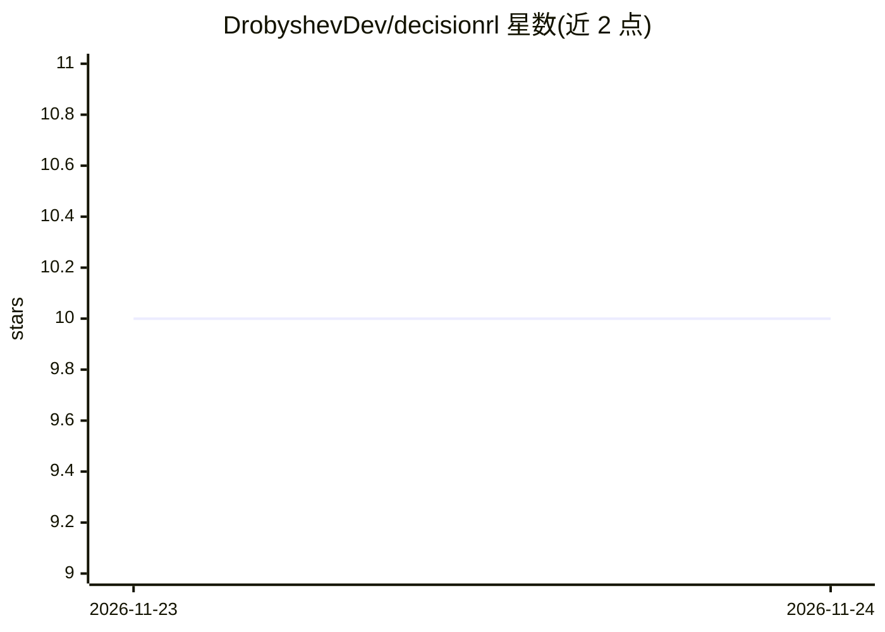

# DrobyshevDev/decisionrl

⭐ 10 · Python · MIT · 推送 2026-11-17 · [GitHub](https://github.com/DrobyshevDev/decisionrl) · [官网](https://drobyshevdev.github.io/decisionrl/) · 个人维护

**面向运营决策的强化学习库：定价/库存/能源等 32 种算法**

针对运营决策（定价、库存、能源、排队、供应链）的强化学习库，区别于面向游戏与机器人控制的常见定位。提供 32 种算法（表格型、深度、模型基、离线、模仿学习），统一 `predict`/`learn`/`save`/`load` 接口；内置 8 个应用环境，每个环境配套经典运筹学基线以便对比。核心依赖 NumPy，PyTorch 为可选扩展，仅训练深度算法时需要；支持 Gymnasium 接口、CLI 训练命令、YAML/JSON 实验配置及追踪记录（git commit、seed、metrics）以保证可复现。

## 筛选速览

| 维度 | 判定 | 备注 |
|---|---|---|
| AI 角色 | `ai-native` | 本体是模型或模型工具 |
| 许可风险 | `permissive` | MIT |
| 部署形态 | `self-host` | docker 或自建部署 |
| 模型依赖 | — | README 未给出锁定关系 |
| 硬件要求 | — | 无带数字的原话,不猜 |
| 安装摩擦 | `low` | 无编译、无系统依赖或容器化 |
| 成熟度 | — | 结构信号不足 |

## 能力要点

- 32 种 RL 算法，统一 predict/learn/save/load 接口
- 8 个运营决策环境均配套经典运筹学基线，对比可复现
- 核心仅依赖 NumPy，PyTorch 为可选扩展
- CLI 训练与 YAML/JSON 实验配置，含追踪记录保证可复现

## 适用场景

- 为库存/定价/能源等运营问题训练 RL 策略并与经典基线对比
- 需要轻依赖（纯 NumPy）环境与求解器的运筹研究场景
- 在 Gymnasium 环境上统一训练多种 RL 算法
- 通过 CLI/YAML 声明式运行可复现实验

## 场景标签

`强化学习` · 领域:训练与推理

## 证据(README 行号)

> L5: Reinforcement learning for operational decisions.
> L26: control suites). `decisionrl` targets operational decisions: pricing, inventory,
> L31: Underneath the applied layer is a dependency-light library of 32 algorithms with a single

## 星数曲线

2026-11-23 10 → 2026-11-24 10（+0）

---
*卡片 v1 · prompt 1.4 · 生成 2026-11-23 · 置信度 mid · 依据 README sha `c4a1bd7152d9` · [字段定义](../../DATASET.md)*
