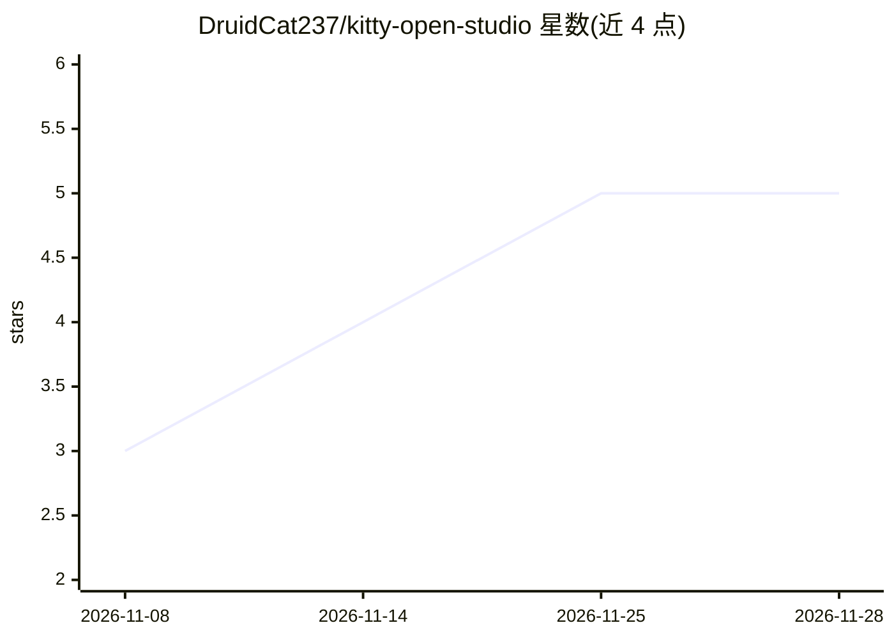

# DruidCat237/kitty-open-studio

⭐ 5 · TypeScript · MIT · 推送 2026-10-28 · [GitHub](https://github.com/DruidCat237/kitty-open-studio) · [官网](https://druidcat.com) · 个人维护

**自托管 AI 视频工作室：基于自有 ComfyUI 生成与剪辑**

一个基于用户自有 ComfyUI 后端的开源自托管应用，提供 33 个精选开放权重工作流，覆盖图片生成、图片编辑、带声音视频、说话角色、放大与补帧；内置时间线编辑器，结果进入项目媒体库。应用本身作为 MCP 服务器，Claude 或 ChatGPT 可通过 MCP 列出工作流、在用户后端生成并按音乐节拍剪辑。后端可运行在 Runpod pod、按秒计费的 serverless 端点或自有 NVIDIA GPU 的 Docker 上；生成全部使用开放权重模型，内置提示词安全过滤。

## 筛选速览

| 维度 | 判定 | 备注 |
|---|---|---|
| AI 角色 | `ai-native` | 本体是模型或模型工具 |
| 许可风险 | `permissive` | MIT |
| 部署形态 | `self-host` | docker 或自建部署 |
| 模型依赖 | locked-api |  |
| 硬件要求 | — | 无带数字的原话,不猜 |
| 安装摩擦 | `low` | 无编译、无系统依赖或容器化 |
| 成熟度 | — | 结构信号不足 |

## 能力要点

- 33 个精选开放权重 ComfyUI 工作流（图片/编辑/有声视频/说话角色/放大/补帧）
- 时间线编辑器与 Studio 卡片，右键片段可直接放大、编辑、动画化或插帧
- 应用作为 MCP 服务器，Claude/ChatGPT 可驱动生成与按节拍剪辑
- 支持 AI 助手按 AGENTS.md 自动完成部署与模型安装

## 适用场景

- 在自己的 GPU 或 Runpod 上生成并剪辑 AI 视频
- 让 Claude/ChatGPT 通过 MCP 按音乐节拍导演 MV
- 为图片做放大、修复与补帧处理
- 用说话与角色替换工作流制作口播内容

## 场景标签

`图像生成` `视频生成` · 领域:内容生成

## 证据(README 行号)

> L3: An open-source, self-hosted AI video studio powered by **your own ComfyUI**.
> L32: - **Studio**: every workflow is a card with a real render and its time on a Runpod GPU. Pick one, fill in the form,
> L93: Every generation runs on open-weights models in your own ComfyUI: no partner nodes, no closed generation APIs, and

## 星数曲线

2026-11-08 3 → 2026-11-28 5（+2）

---
*卡片 v1 · prompt 1.4 · 生成 2026-11-24 · 置信度 high · 依据 README sha `043bc512c2b0` · [字段定义](../../DATASET.md)*
