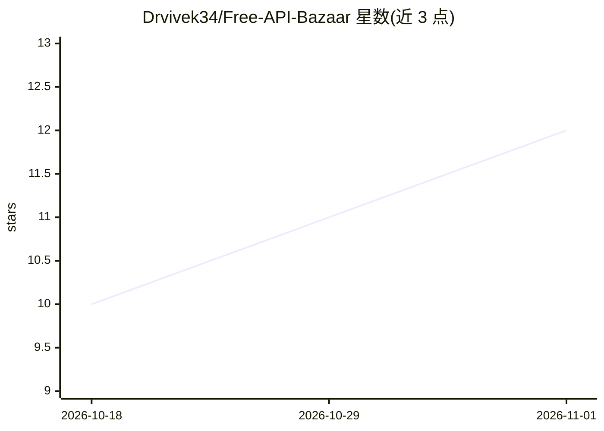

# Drvivek34/Free-API-Bazaar

⭐ 12 · Python · NOASSERTION · 推送 2026-08-24 · [GitHub](https://github.com/Drvivek34/Free-API-Bazaar) · 个人维护

**免费 LLM 与 AI API 的社区编目清单（含真实限额）**

社区维护的免费 AI API 目录（前身为 awesome free LLM API resources）：收录提供免费或免费额度访问的 LLM、图像、音频、视频、嵌入与多模态 API，记录真实限额、OpenAI 兼容性与注册链接；当前快照含 93 条 provider 记录并标注验证日期。按 16 个类别组织（音频、代码模型、网关路由、搜索与 Web、本地自托管等），每个条目独立子目录并保留来源、作者与原许可。仓库结构与文本采用 MIT，收录条目保留原作者许可。

## 筛选速览

| 维度 | 判定 | 备注 |
|---|---|---|
| AI 角色 | `ai-knowledge` | 知识聚合/清单类 |
| 许可风险 | `none` | NOASSERTION |
| 部署形态 | `None` |  |
| 模型依赖 | — | README 未给出锁定关系 |
| 硬件要求 | — | 无带数字的原话,不猜 |
| 安装摩擦 | `low` | 无编译、无系统依赖或容器化 |
| 成熟度 | — | 结构信号不足 |

## 能力要点

- 93 条 provider 记录，含限额、模型列表与验证日期
- 16 个顶层类别，覆盖 LLM、图像、音频、搜索、浏览器与 CLI 工具
- 每个 API 独立子目录，记录来源、作者与原许可
- 提示所有额度均有时效性，需核验 provider 页面

## 适用场景

- 为项目寻找免费或免费额度的 LLM/AI API
- 对比各 provider 的限额与 OpenAI 兼容性
- 查找本地自托管或网关路由类免费方案

## 场景标签

`精选清单` · 领域:学习与行业

## 证据(README 行号)

> L3: > A categorized, community-maintained directory of free LLM & AI APIs.
> L7: Free API Bazaar (formerly awesome free LLM API resources) is a living catalog of providers that offer free or free-t

## 星数曲线

2026-10-18 10 → 2026-11-01 12（+2）

---
*卡片 v1 · prompt 1.4 · 生成 2026-11-01 · 置信度 high · 依据 README sha `7ca3df89b586` · [字段定义](../../DATASET.md)*
