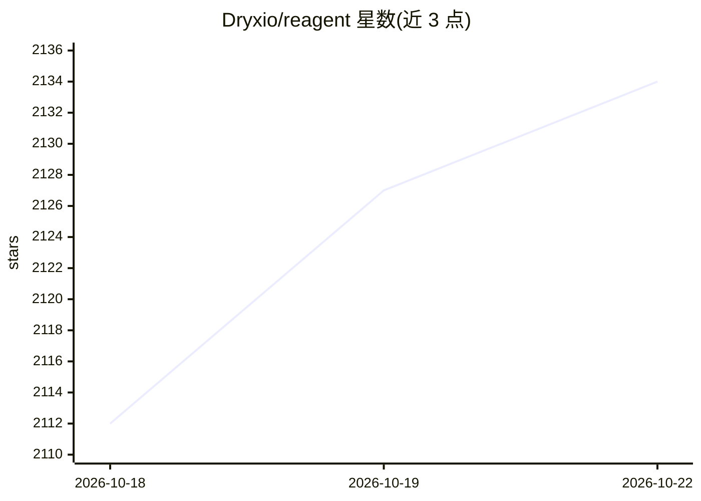

# Dryxio/reagent

⭐ 2,153 · Python · MIT · 推送 2026-09-09 · [GitHub](https://github.com/Dryxio/reagent) · 个人维护

**用 Ghidra+LLM 从二进制重建并验证 C/C++ 函数的逆向 agent**

开源 Python 逆向工程 agent（PyPI 包 auto-re-agent）：通过 Ghidra 及其查询桥获取反编译、交叉引用、CFG 等证据，驱动 LLM（Claude API/CLI、Codex CLI、OpenAI 兼容 API）生成候选 C/C++ 实现，再经 LLM checker、结构化验证、构建/测试门禁与 11 个奇偶校验信号做保守验证；不自动改写原源码树。提供 manifest 批量规划、dry-run、成本预算与证据导出等 CLI。成功逆向需同时满足 checker PASS、结构无强失配、验证策略与奇偶策略通过。

## 筛选速览

| 维度 | 判定 | 备注 |
|---|---|---|
| AI 角色 | `ai-native` | 本体是模型或模型工具 |
| 许可风险 | `permissive` | MIT |
| 部署形态 | `library` | 以包/库形式分发 |
| 模型依赖 | locked-api |  |
| 硬件要求 | — | 无带数字的原话,不猜 |
| 安装摩擦 | `medium` | 含编译或系统依赖之一 |
| 成熟度 | — | 结构信号不足 |

## 能力要点

- 独立 reverser/checker 模型与 agentic 证据收集（decompile/xrefs/struct/vtable 等）
- 四重验收条件：checker PASS + 结构验证 + 验证策略 + 奇偶校验（11 个内置信号）
- 候选代码写入隔离项目副本执行构建/测试验证，不直接改写原源码
- 支持 Claude API/CLI、Codex CLI 与 OpenAI 兼容 API，可设 max_budget_usd 成本上限

## 适用场景

- 从编译后二进制恢复单个或成批 C/C++ 函数的源码
- 对已有源码函数跑奇偶校验分析（re-agent parity）
- 在隔离副本中构建并验证 LLM 生成的候选实现

## 场景标签

`网络安全` `编码 Agent` · 领域:编码与开发

## 证据(README 行号)

> L8: ReAgent is an open-source AI reverse-engineering agent that uses Ghidra
> L9: and LLMs—including Claude, Codex, and OpenAI-compatible models—to reconstruct
> L10: and validate C/C++ functions from compiled binaries. It combines independent

## 星数曲线

2026-10-18 2,112 → 2026-10-22 2,134（+22）

---
*卡片 v1 · prompt 1.4 · 生成 2026-10-21 · 置信度 high · 依据 README sha `dcc2f0d7a811` · [字段定义](../../DATASET.md)*
