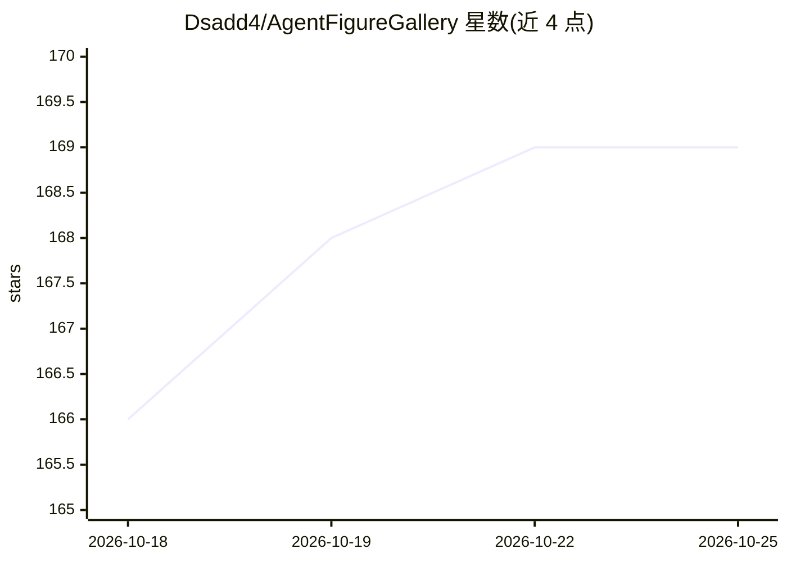

# Dsadd4/AgentFigureGallery

⭐ 169 · Python · MIT · 推送 2026-09-05 · [GitHub](https://github.com/Dsadd4/AgentFigureGallery) · [官网](https://huggingface.co/datasets/dsadd4/AgentFigureGallery) · 个人维护 · 中文 README

**给编程 agent 的科研绘图参考库技能：供其生成出版级图表**

汇集主要来自 Nature 系期刊的科研图表及配套绘图代码，构成 16,341 个视觉候选、10 类图表类型的公共参考池。工作流为：agent 查询视觉参考 → 用户在浏览器画廊中标记喜欢/拒绝/选择 → 导出参考束 → agent 据此生成绘图代码。以 Python 包与 CLI 形式提供，支持为 Codex、Claude Code、Cursor 安装技能包装器，参考池通过 Hugging Face 清单安装，另有社区贡献扩展路径。需 Python 3.10+。

## 筛选速览

| 维度 | 判定 | 备注 |
|---|---|---|
| AI 角色 | `ai-ecosystem` | LLM/agent 周边工具 |
| 许可风险 | `permissive` | MIT |
| 部署形态 | `library` | 以包/库形式分发 |
| 模型依赖 | locked-api |  |
| 硬件要求 | — | 无带数字的原话,不猜 |
| 安装摩擦 | `low` | 无编译、无系统依赖或容器化 |
| 成熟度 | — | 结构信号不足 |

## 能力要点

- 16,341 个视觉候选，覆盖 10 类常见科研图表
- 浏览器画廊人机工作流：标记偏好并导出参考束供 agent 使用
- 支持 Codex / Claude Code / Cursor 技能包装器安装
- 支持通过社区包与扩展指南扩充参考池

## 适用场景

- 让 Codex / Claude Code / Cursor 参考期刊风格生成出版级图表
- 在浏览器画廊中按个人或实验室偏好筛选图表样式
- 为特定图表类型扩充并维护本地参考库

## 场景标签

`科研工具` · 领域:学习与行业

## 证据(README 行号)

> L32: agent query -> browser gallery -> human like/reject/select -> reference bundle -> plotting code
> L35: Before generating plotting code, the agent queries visual references, the user selects preferred examples in the br

## 星数曲线

2026-10-18 166 → 2026-10-25 169（+3）

---
*卡片 v1 · prompt 1.4 · 生成 2026-10-22 · 置信度 high · 依据 README sha `aa64f5d2d3cd` · [字段定义](../../DATASET.md)*
