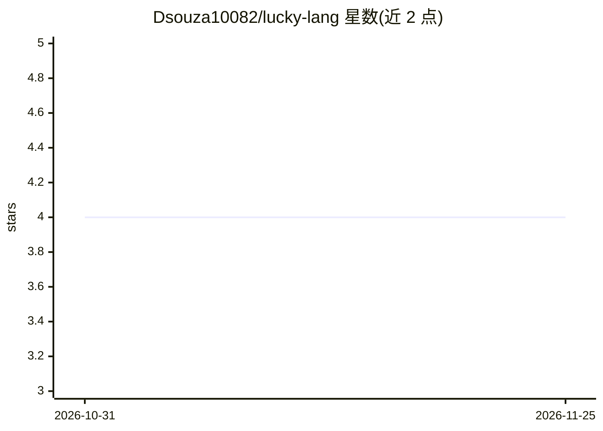

# Dsouza10082/lucky-lang

⭐ 4 · Shell · MIT · 推送 2026-10-24 · [GitHub](https://github.com/Dsouza10082/lucky-lang) · 个人维护

**派生自 Go 的编程语言，面向高性能应用、游戏、GUI 与私有 AI**

Lucky 是一个派生自 Go 的编程语言设计项目，目标是保留 Go 的语法、模块与交叉编译，同时以所有权、区域与显式释放替代垃圾回收，并通过静态检查保证内存安全。语言方向上还包含带载荷的枚举、Result 错误传播、async/await 与 goroutine 并发、面向游戏的数据布局（SoA/ECS）、基于 Fyne 的跨平台 GUI，以及用于类型化私有 AI 工作流的 tacScript。当前状态为 pre-alpha，语言、运行时与 SDK 均未实现，仓库现仅包含可复现的上游基线（Go/Fyne/TAC 的固定版本构建脚本与证据）。

## 筛选速览

| 维度 | 判定 | 备注 |
|---|---|---|
| AI 角色 | `ai-enhanced` | 去掉 AI 部分产品仍成立 |
| 许可风险 | `permissive` | MIT |
| 部署形态 | `None` |  |
| 模型依赖 | — | README 未给出锁定关系 |
| 硬件要求 | — | 无带数字的原话,不猜 |
| 安装摩擦 | `low` | 无编译、无系统依赖或容器化 |
| 成熟度 | `idea` | |

## 能力要点

- 以所有权、区域与显式分配替代 GC，含 GC 回退模式
- 保留 .go 文件 Go 语法，提出 .lk 文件启用 Lucky 扩展
- 设计目标含 SoA/ECS、Fyne GUI 与 tacScript 私有 AI 工作流
- 提供固定上游版本的基线复现脚本（git/curl/C 编译器/Go 1.21+）

## 适用场景

- 跟踪该语言设计目标与规范进展
- 复现 pinned 上游基线用于对照验证
- 为无 GC 高性能场景做语言设计的参考

## 场景标签

 · 领域:编程语言/开发工具

## 证据(README 行号)

> L5: Lucky is a programming language derived from Go, aimed at high-performance
> L6: applications, games, cross-platform GUIs and private AI. It keeps Go's syntax,
> L30: - **Games, GUI and AI.** Data-oriented design (SoA, ECS), a GUI built on Fyne for
> L31:  desktop, mobile and the browser (WebGL), and tacScript, built on TAC Lang, for

## 星数曲线

2026-10-31 4 → 2026-11-25 4（+0）

---
*卡片 v1 · prompt 1.4 · 生成 2026-11-21 · 置信度 mid · 依据 README sha `3e1d14e814c1` · [字段定义](../../DATASET.md)*
