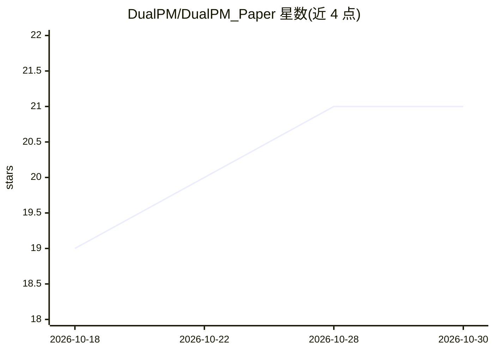

# DualPM/DualPM_Paper

⭐ 21 · Python · BSD-3-Clause · 推送 2025-11-04 · [GitHub](https://github.com/DualPM/DualPM_Paper) · [官网](https://dualpm.github.io/) · 组织维护

**CVPR 2025 论文代码：图像到 3D 形状与位姿重建（双点图）**

牛津团队 CVPR 2025 Highlight 论文 DualPM 的训练、推理与部分基准测试代码：将可变形物体的分析任务化为从单张图像预测一对点图（相机空间与规范空间），由神经网络预测，实现 3D 物体重建等任务。安装需克隆仓库并 pip 安装，依赖 CUDA（nvdiffrast）；推理需离线提取 ODISE-DINO 特征（sd-dino 封装）；解码器权重发布于 Hugging Face。

## 筛选速览

| 维度 | 判定 | 备注 |
|---|---|---|
| AI 角色 | `ai-native` | 本体是模型或模型工具 |
| 许可风险 | `permissive` | BSD-3-Clause |
| 部署形态 | `library` | 以包/库形式分发 |
| 模型依赖 | — | README 未给出锁定关系 |
| 硬件要求 | — | 无带数字的原话,不猜 |
| 安装摩擦 | `medium` | 含编译或系统依赖之一 |
| 成熟度 | — | 结构信号不足 |

## 能力要点

- 相机空间与规范空间双点图的 3D 形状与位姿重建
- 提供训练、推理脚本与配置
- 解码器权重以 Hugging Face automodel 形式发布
- 基准代码 AnimodelPoints（Animodel 的点云配置衍生）

## 适用场景

- 复现论文训练与推理流程
- 从单张图像重建可变形物体的 3D 形状与位姿
- 在 AnimodelPoints 点云基准上评测

## 场景标签

`图像视频处理` · 领域:感知与多模态

## 证据(README 行号)

> L22: **DualPM** is a novel approach for 3D shape and pose reconstruction using dual posed-canonical point maps. Dual Poi
> L3:  CVPR 2025 - Conference Highlight

## 星数曲线

2026-10-18 19 → 2026-10-30 21（+2）

---
*卡片 v1 · prompt 1.4 · 生成 2026-10-28 · 置信度 high · 依据 README sha `4cc943347fba` · [字段定义](../../DATASET.md)*
