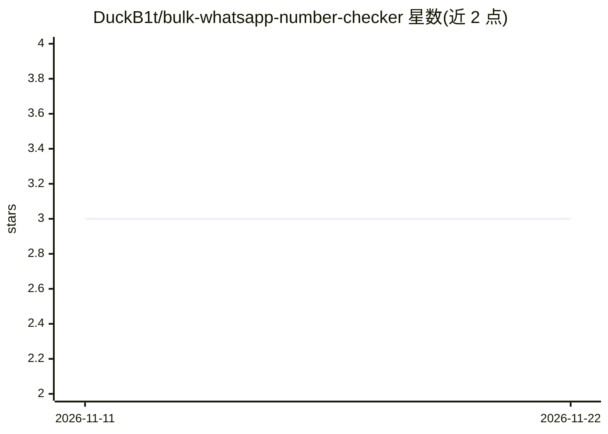

# DuckB1t/bulk-whatsapp-number-checker

⭐ 3 · JavaScript · MIT · 推送 2026-10-09 · [GitHub](https://github.com/DuckB1t/bulk-whatsapp-number-checker) · 个人维护

**隐私优先的 WhatsApp 号码批量验证 Chrome 扩展，带可选 MCP 桥**

BWAV 是一个 Manifest V3 Chrome 扩展，通过驱动用户自己已登录的 WhatsApp Web 标签页并读取页面状态，判定号码是否注册（REGISTERED/NOT_REGISTERED/UNKNOWN/INVALID），支持单个与批量检查、Excel/CSV 粘贴导入、国家码归一化、HTML/CSV 报告导出。零依赖、纯 vanilla JS、无构建步骤，数据仅存本地。内置一个默认关闭、仅监听 127.0.0.1 且带 token 的 MCP 服务器，供 AI agent 调用检查工具。

## 筛选速览

| 维度 | 判定 | 备注 |
|---|---|---|
| AI 角色 | `ai-enhanced` | 去掉 AI 部分产品仍成立 |
| 许可风险 | `permissive` | MIT |
| 部署形态 | `None` |  |
| 模型依赖 | — | README 未给出锁定关系 |
| 硬件要求 | — | 无带数字的原话,不猜 |
| 安装摩擦 | `low` | 无编译、无系统依赖或容器化 |
| 成熟度 | — | 结构信号不足 |

## 能力要点

- 通过自有 WhatsApp Web 会话读取页面判定注册状态，无第三方 API 与服务器
- 批量导入带解析器，归一化国家码、分隔符与格式
- 可选 MCP 桥（默认关闭、localhost-only、token 保护），提供 check_whatsapp_number(s) 工具
- 零依赖 vanilla JS，无构建步骤

## 适用场景

- 批量核验名单中哪些号码注册了 WhatsApp
- 让本地 AI agent 通过 MCP 工具代为执行号码检查
- 导出 HTML/CSV 报告用于后续处理

## 场景标签

`浏览器自动化` · 领域:效率与自动化

## 证据(README 行号)

> L11: BWAV is a Chrome extension that tells you whether a phone number is on WhatsApp, one at a time or by the hundreds. 
> L25: - **AI-agent ready.** Optional MCP bridge so AI agents (Claude, opencode, Cursor) can run checks through the same e
> L81: BWAV ships a zero-dependency MCP server (`mcp/server.js`) so AI agents can check numbers through your real, logged-

## 星数曲线

2026-11-11 3 → 2026-11-22 3（+0）

---
*卡片 v1 · prompt 1.4 · 生成 2026-11-22 · 置信度 high · 依据 README sha `ad3c2b7df41e` · [字段定义](../../DATASET.md)*
