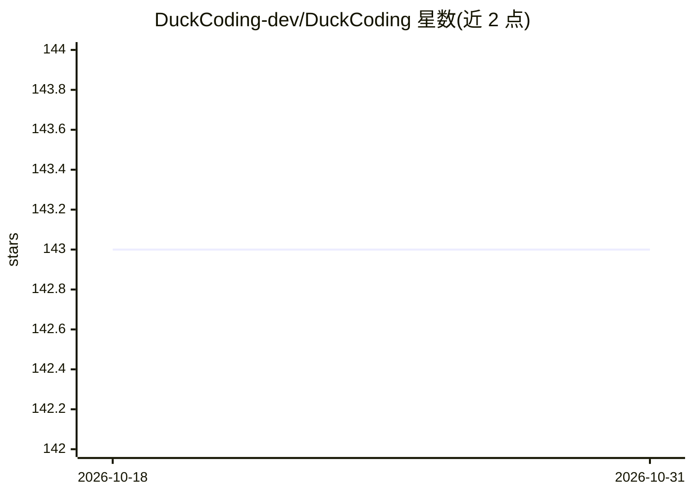

# DuckCoding-dev/DuckCoding

⭐ 143 · Rust · AGPL-3.0 · 推送 2026-02-19 · [GitHub](https://github.com/DuckCoding-dev/DuckCoding) · [官网](https://duckcoding.com) · 组织维护 · 中文 README

**一键安装配置 Claude Code/Codex/Gemini CLI 的跨平台桌面管理工具**

基于 Tauri 2 + React 的桌面应用，面向同时使用多个 AI 编程 CLI 的开发者：统一检测、安装、更新 Claude Code、CodeX 与 Gemini CLI（含 Local/WSL/SSH 多环境实例）；Profile 多配置隔离，切换时仅替换 API Key/Base URL，保留原生个性化设置；三工具各自独立透明代理（8787/8788/8789 端口）带会话级配置与防回环；另提供多供应商余额监控与自定义 JS 提取器。数据全部本地存储于 ~/.duckcoding，不收集用户数据。提供 macOS/Windows/Linux 安装包，不支持 WSL GUI。

## 筛选速览

| 维度 | 判定 | 备注 |
|---|---|---|
| AI 角色 | `ai-ecosystem` | LLM/agent 周边工具 |
| 许可风险 | `viral` | AGPL-3.0 |
| 部署形态 | `desktop` | 安装包/桌面程序 |
| 模型依赖 | — | README 未给出锁定关系 |
| 硬件要求 | — | 无带数字的原话,不猜 |
| 安装摩擦 | `medium` | 含编译或系统依赖之一 |
| 成熟度 | — | 结构信号不足 |

## 能力要点

- 三款 AI CLI 工具的自动检测、一键安装/更新与版本校验（npm/brew/官方方式识别）
- Profile 多配置隔离，仅替换 API Key/Base URL，保留主题/快捷键等原生设置
- 三工具独立透明代理（8787/8788/8789），会话级配置、自启动、回环检测
- 多供应商余额监控：NewAPI/OpenAI 预设模板 + 自定义 JS 提取器

## 适用场景

- 同时使用多个 AI 编程 CLI 时统一安装、更新与切换配置
- 工作/个人多账号快速切换，不丢失各工具的个性化设置
- 为 Claude Code 等工具配置透明代理并查看会话流量
- 在一个界面里监控多家 API 供应商的余额与用量

## 场景标签

 · 领域:开发者工具/AI CLI 管理

## 证据(README 行号)

> L22: - 统一管理 Claude Code、CodeX、Gemini CLI，自动识别 npm/brew/官方安装方式
> L31: - 工具管理：自动检测/安装/更新；支持 Local/WSL/SSH；识别安装方式并校验版本

## 星数曲线

2026-10-18 143 → 2026-10-31 143（+0）

---
*卡片 v1 · prompt 1.4 · 生成 2026-10-22 · 置信度 mid · 依据 README sha `cf6862c8ab5f` · [字段定义](../../DATASET.md)*
