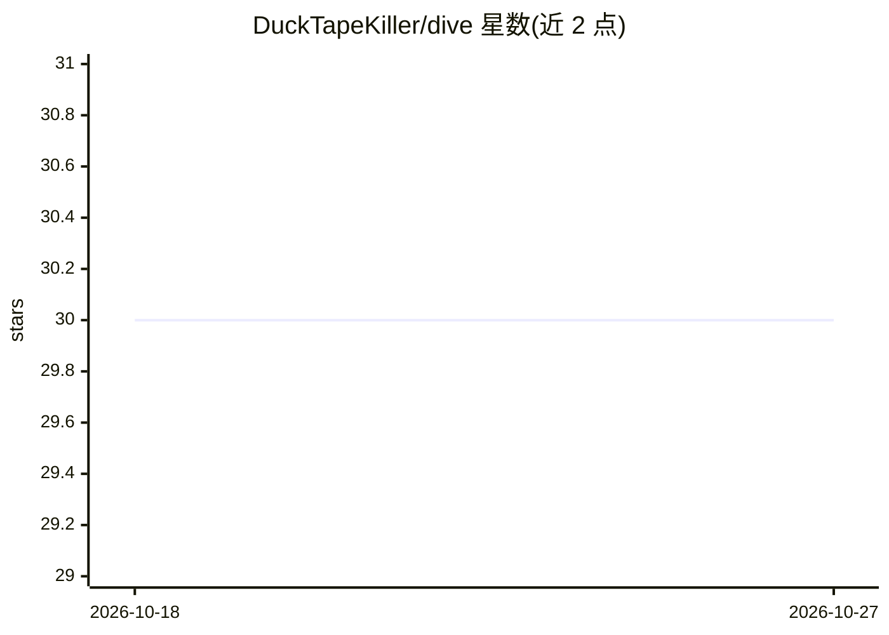

# DuckTapeKiller/dive

⭐ 30 · JavaScript · MIT · 推送 2026-10-25 · [GitHub](https://github.com/DuckTapeKiller/dive) · 个人维护

**本地优先的桌面聊天与 Agent 客户端，接入多种本地/云端模型后端**

运行在本机的桌面应用与 Web UI，提供五种聊天模式分别对接 LM Studio、Ollama、Pi 编码 agent CLI、云端 API（OpenAI/Anthropic/Mistral/Google）与 llama.cpp 的 llama-server。支持 OpenAI schema 原生工具调用、MCP 服务器接入、SKILL.md 格式 Agent Skills、插件扩展。内置基于 SQLite 与 sqlite-vec 的离线 RAG 引擎，可对 Calibre EPUB 库与笔记建索引并给出带引用段落的回答。本地模式无需联网；预编译 macOS 应用未签名，需 Node.js 20+ 与至少一个后端。

## 筛选速览

| 维度 | 判定 | 备注 |
|---|---|---|
| AI 角色 | `ai-ecosystem` | LLM/agent 周边工具 |
| 许可风险 | `permissive` | MIT |
| 部署形态 | `library` | 以包/库形式分发 |
| 模型依赖 | local-ok | 支持本地模型 |
| 硬件要求 | — | 无带数字的原话,不猜 |
| 安装摩擦 | `low` | 无编译、无系统依赖或容器化 |
| 成熟度 | — | 结构信号不足 |

## 能力要点

- 五种聊天模式各持独立会话、提示词与工具配置，互不串扰
- 基于 SQLite + sqlite-vec 的离线混合检索（向量+FTS），零额外安装即用
- 支持 MCP 服务器、自定义 shell/JS 工具、Node.js 插件与 SKILL.md Agent Skills
- 可代管 llama-server 并提供后台常驻服务配置方案

## 适用场景

- 在同一界面内切换本地与云端模型进行对话和 agent 任务
- 对自己的电子书库与笔记建立私有索引并问答
- 通过 Pi 模式在图形界面中运行文件/终端 agent 任务

## 场景标签

`聊天机器人` `文档问答` `编码 Agent` · 领域:编码与开发

## 证据(README 行号)

> L5: ## A Local-First Chat & Agent Interface for LM Studio, Ollama, Pi, llama.cpp, and Cloud Models
> L9: Dive is a local-first desktop app (and web UI) with a flat, brutalist interface for working with local AI backends, 
> L21: |**Ollama**|local Ollama server|offline chat, skills, agent workflows|

## 星数曲线

2026-10-18 30 → 2026-10-27 30（+0）

---
*卡片 v1 · prompt 1.4 · 生成 2026-10-26 · 置信度 high · 依据 README sha `9d794efe86b4` · [字段定义](../../DATASET.md)*
