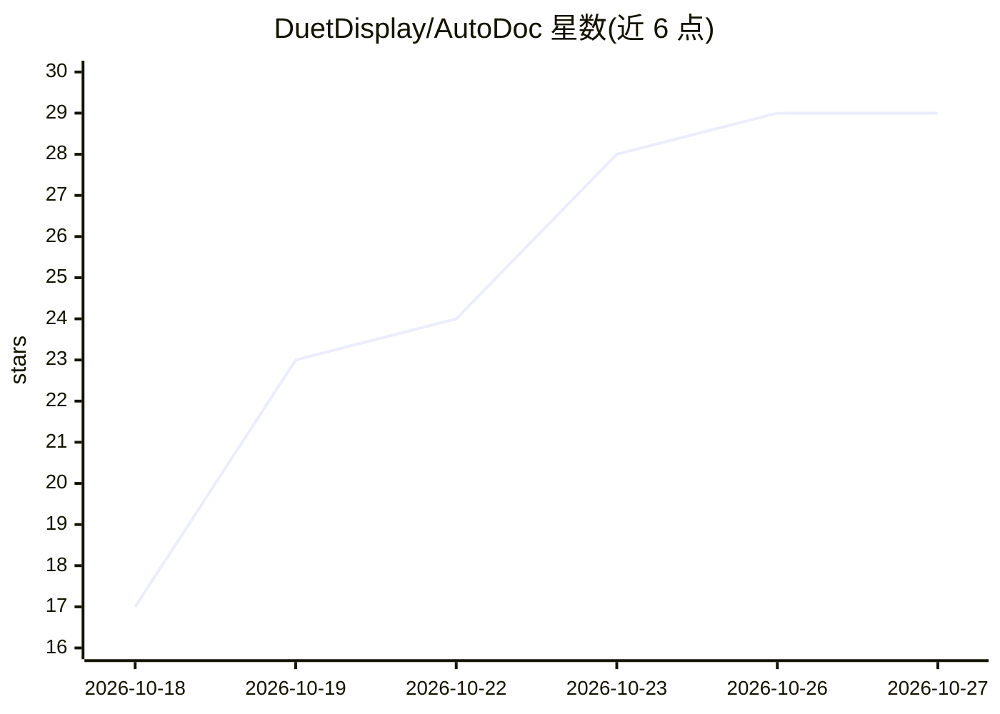

# DuetDisplay/AutoDoc

⭐ 29 · TypeScript · AGPL-3.0 · 推送 2026-10-21 · [GitHub](https://github.com/DuetDisplay/AutoDoc) · [官网](https://getautodoc.com/) · 组织维护

**本地处理的 AI 会议记录应用，录音转写并生成笔记**

面向 macOS（Apple Silicon）与 Windows x64 的本地优先会议笔记 Electron 桌面应用：检测会议开始（Zoom/Meet/Teams/Webex/Slack）后录制屏幕、麦克风与系统音频多轨流，在设备上完成转写（Parakeeet/MLX Distil Whisper/Canary/Whisper large-v3-turbo，支持 27 种语言）、生成可编辑笔记，并通过自管理的本地 Ollama 实例做摘要与跨会议 Ask AI。录音与转写以 AES-256-GCM 加密存储，笔记可导出 PDF/Word/Markdown。提供官方安装包，无需账号或 AI API key；8 GB 机器仅支持英语且使用较小的 llama3.2:3b 模型。

## 筛选速览

| 维度 | 判定 | 备注 |
|---|---|---|
| AI 角色 | `ai-native` | 本体是模型或模型工具 |
| 许可风险 | `viral` | AGPL-3.0 |
| 部署形态 | `desktop` | 安装包/桌面程序 |
| 模型依赖 | local-ok | 支持本地模型 |
| 硬件要求 | `cpu-ok` | |
| 安装摩擦 | `medium` | 含编译或系统依赖之一 |
| 成熟度 | — | 结构信号不足 |

## 能力要点

- 端到端本地流程：检测→录制→转写→笔记→时间戳回放→Ask AI
- 转写模型按语言与硬件选择，支持 27 种会议语言
- 本地 Ollama 实例由应用自行管理，无需 API key
- 录像/转写 AES-256-GCM 加密，密钥经 macOS Keychain 或 Windows DPAPI 保护

## 适用场景

- 录制线上会议并自动生成可编辑的带时间戳笔记
- 不把会议内容送往云端的前提下获得 AI 会议纪要
- 跨历史会议全文搜索并向 AI 提问

## 场景标签

`语音识别` `AI 写作` · 领域:内容生成

## 证据(README 行号)

> L7: AutoDoc is an open-source, local-first meeting notes app for macOS and Windows. Record your screen and meeting audio
> L40: - End-to-end local workflow: detect → record → transcribe → notes → replay key moments → Ask AI
> L54: - **💬 Ask AI** — ask questions across your meetings and get grounded answers, entirely on-device.

## 星数曲线

2026-10-18 17 → 2026-10-27 29（+12）

---
*卡片 v1 · prompt 1.4 · 生成 2026-10-26 · 置信度 high · 依据 README sha `5bbda7bfeda1` · [字段定义](../../DATASET.md)*
