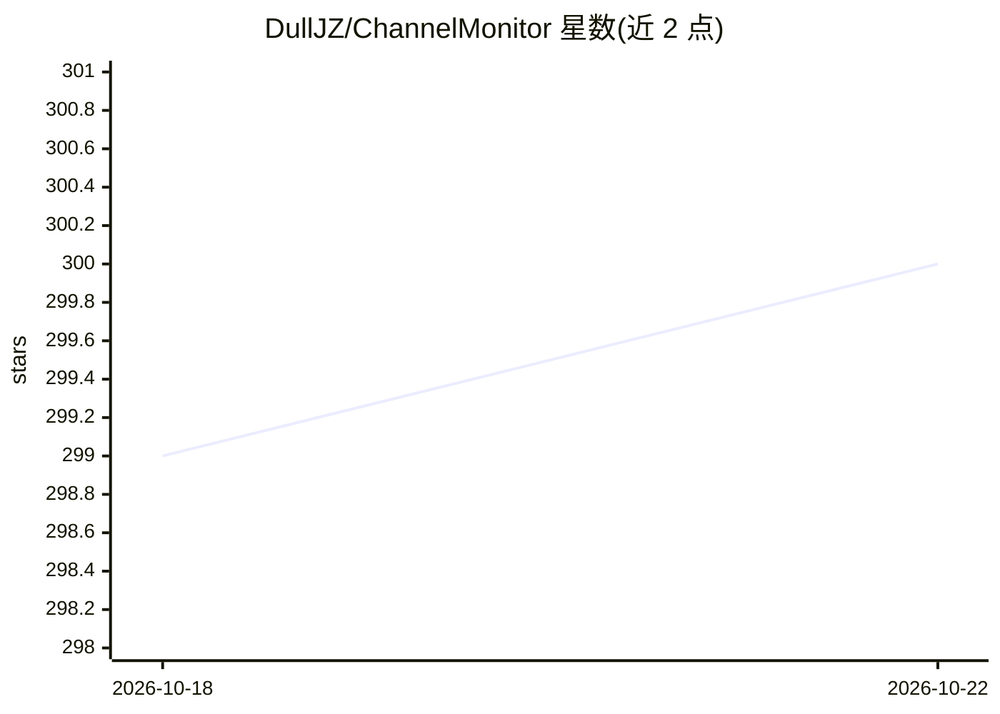

# DullJZ/ChannelMonitor

⭐ 300 · Go · 推送 2026-10-21 · [GitHub](https://github.com/DullJZ/ChannelMonitor) · 个人维护

**监控 OneAPI/NewAPI/OneHub 渠道模型可用性的自动化工具**

面向自建 OneAPI/NewAPI/OneHub 网关的运维监控工具：直接读取 channels 数据表，按可配置间隔并发测试每个渠道的模型可用性（带 RPS/RPM 限流），根据请求成败更新可用模型并写回数据库，实现渠道自动监控。支持 MySQL/SQLite/PostgreSQL/SQL Server 四种数据库、渠道与模型排除、Uptime Kuma 推送可视化、SMTP 邮件与 Telegram Bot 更新通知。提供二进制下载与 Docker/Docker Compose 两种部署方式，JSON 或 YAML 配置。

## 筛选速览

| 维度 | 判定 | 备注 |
|---|---|---|
| AI 角色 | `ai-ecosystem` | LLM/agent 周边工具 |
| 许可风险 | `none` | — |
| 部署形态 | `desktop` | 安装包/桌面程序 |
| 模型依赖 | — | README 未给出锁定关系 |
| 硬件要求 | — | 无带数字的原话,不猜 |
| 安装摩擦 | `low` | 无编译、无系统依赖或容器化 |
| 成熟度 | — | 结构信号不足 |

## 能力要点

- 直接读写 OneAPI/NewAPI 数据库并自动更新可用模型
- 并发测试与 RPS/RPM 请求限流控制
- 支持 MySQL、SQLite、PostgreSQL、SQL Server 四种数据库
- Uptime Kuma 推送可视化与 SMTP/Telegram 通知

## 适用场景

- 自建 OneAPI/NewAPI 网关后自动检测失效渠道减少错误返回
- 通过 Uptime Kuma 面板可视化查看各模型可用性
- 渠道变更时收到邮件或 Telegram 通知

## 场景标签

`LLM 可观测性` · 领域:评测与运维

## 证据(README 行号)

> L7: Channel Monitor is a tool designed for monitoring OneAPI/NewAPI channels. It directly reads the channels data table 
> L11: - [x] Directly read and write to the OneAPI/NewAPI database

## 星数曲线

2026-10-18 299 → 2026-10-22 300（+1）

---
*卡片 v1 · prompt 1.4 · 生成 2026-10-21 · 置信度 high · 依据 README sha `d56533069626` · [字段定义](../../DATASET.md)*
