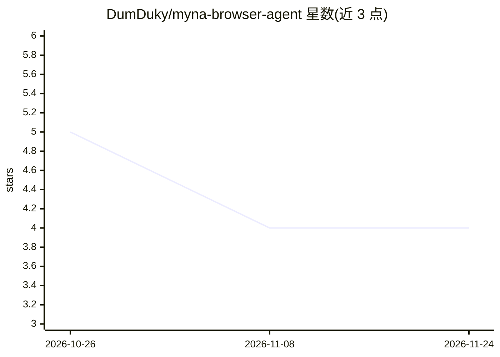

# DumDuky/myna-browser-agent

⭐ 4 · JavaScript · MIT · 推送 2026-10-25 · [GitHub](https://github.com/DumDuky/myna-browser-agent) · 个人维护

**开源版 Claude in Chrome：自带 API Key 的浏览器侧边栏 AI 代理**

一个 Chrome 侧边栏扩展，将 AI 浏览器代理嵌入浏览器：模型直连用户配置的 provider，聊天记录存于 Chrome 本地。提供 4 种权限模式（Ask first/Auto-run/Plan first/Read only）、敏感站点强制确认、拒绝输入密码与卡号字段、提示注入防护。支持远程 MCP 工具接入、每日/每周定时任务、18+ 个工具（读页/点击/填表/截图/多标签研究/GIF 导出）。无构建步骤，需 Chrome 116+，无法读取 chrome:// 等受保护页面。

## 筛选速览

| 维度 | 判定 | 备注 |
|---|---|---|
| AI 角色 | `ai-native` | 本体是模型或模型工具 |
| 许可风险 | `permissive` | MIT |
| 部署形态 | `desktop` | 安装包/桌面程序 |
| 模型依赖 | local-ok | 支持本地模型 |
| 硬件要求 | — | 无带数字的原话,不猜 |
| 安装摩擦 | `low` | 无编译、无系统依赖或容器化 |
| 成熟度 | `idea` | |

## 能力要点

- 支持 Anthropic/OpenAI/Gemini/Ollama 等 16 个 provider 预设，模型直连
- 4 种权限模式与站点规则，敏感站点（银行/支付/政府）强制确认
- MCP 远程工具接入与每日/每周定时任务
- 无构建步骤、无后端、无遥测，密钥可存 session-only

## 适用场景

- 在浏览器侧边栏让 AI 总结当前页面并对比多个标签页
- 让 AI 帮我填写表单但提交前由我确认
- 接入本地 Ollama 模型做不联网的页面操作
- 配置每日定时任务自动执行浏览器操作并通知结果

## 场景标签

`浏览器自动化` `AI 助手` · 领域:效率与自动化

## 证据(README 行号)

> L32: Myna puts an AI browser agent in Chrome's side panel. It uses the model provider you choose, talks to that provider
> L6:  Bring your own model. Let an AI agent read, click, fill, and research across your tabs.

## 星数曲线

2026-10-26 5 → 2026-11-24 4（-1）

---
*卡片 v1 · prompt 1.4 · 生成 2026-11-21 · 置信度 high · 依据 README sha `a3453fded78a` · [字段定义](../../DATASET.md)*
