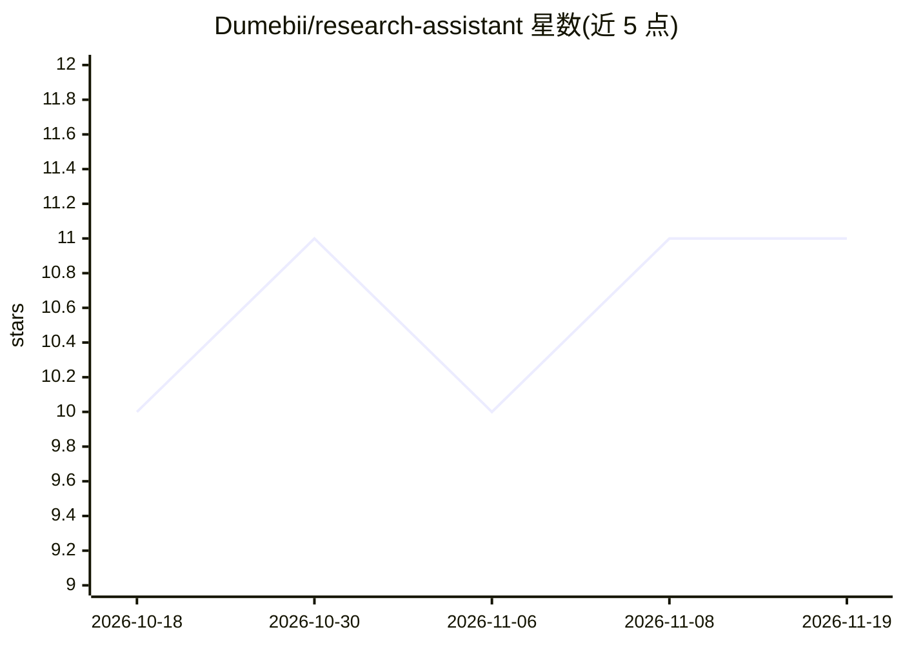

# Dumebii/research-assistant

⭐ 11 · TypeScript · 推送 2026-01-14 · [GitHub](https://github.com/Dumebii/research-assistant) · [官网](https://v0-vizify-nine-pi.vercel.app/) · 个人维护

**面向研究者的论文转多媒体工具：生成幻灯片、播客脚本与摘要**

基于 React + Supabase 的 Web 应用，将学术论文转换为幻灯片、播客脚本、执行摘要与信息图等易传播格式，AI 引擎为通过 API 调用的 Grok（xAI）。支持上传 .pdf/.docx/.txt 或粘贴文本，提供 Supabase 邮箱认证与深色响应式界面。README 标注其为周末构建的 vibe-coded 项目，可本地通过 git clone + npm 运行，亦可部署至 Vercel。

## 筛选速览

| 维度 | 判定 | 备注 |
|---|---|---|
| AI 角色 | `ai-native` | 本体是模型或模型工具 |
| 许可风险 | `none` | — |
| 部署形态 | `library` | 以包/库形式分发 |
| 模型依赖 | locked-api |  |
| 硬件要求 | — | 无带数字的原话,不猜 |
| 安装摩擦 | `low` | 无编译、无系统依赖或容器化 |
| 成熟度 | — | 结构信号不足 |

## 能力要点

- 论文转四种格式：播客脚本、幻灯片、执行摘要、信息图内容
- 支持上传 PDF/DOCX/TXT 或粘贴原始文本
- Supabase 邮箱认证与后端数据库
- AI 引擎为通过 API 调用的 Grok

## 适用场景

- 把一篇论文快速做成可分享的幻灯片
- 为论文生成播客脚本来传播研究内容
- 提取论文的简明执行摘要

## 场景标签

`科研工具` `AI 写作` · 领域:内容生成

## 证据(README 行号)

> L3: ResearchAI Assistant is a web-based tool that transforms academic papers into accessible content formats—slides, pod
> L23: |AI Engine|Grok AI (via API)|

## 星数曲线

2026-10-18 10 → 2026-11-19 11（+1）

---
*卡片 v1 · prompt 1.4 · 生成 2026-11-19 · 置信度 high · 依据 README sha `1aebc279e361` · [字段定义](../../DATASET.md)*
