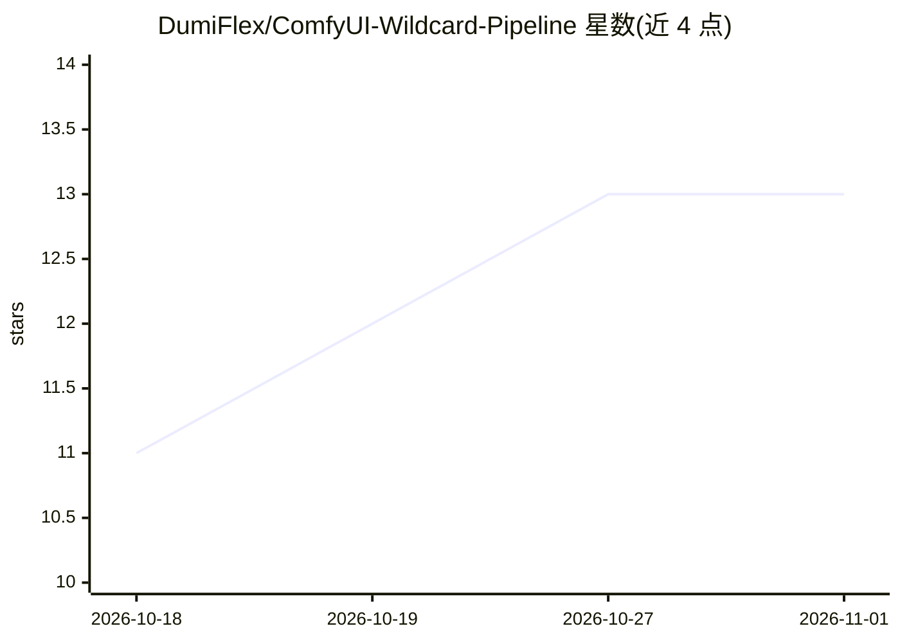

# DumiFlex/ComfyUI-Wildcard-Pipeline

⭐ 13 · TypeScript · GPL-3.0 · 推送 2026-10-29 · [GitHub](https://github.com/DumiFlex/ComfyUI-Wildcard-Pipeline) · [官网](https://wp.dumiflex.dev) · 组织维护

**ComfyUI 模块化提示词生成扩展：按上下文逐步构建随机提示词**

面向 ComfyUI 用户的自定义节点扩展，用于程序化生成相互协调的随机提示词：模块在 WP Context 内解析并输出 $变量，由 WP Prompt Assembler 填入模板后交给 CLIP Text Encode。模块类型含加权 Wildcard、固定值、组合、If/else 推导、约束与 Bundle，可嵌套引用；支持循环与 Seed List 做逐次变体。附带 Vue 构建的本地管理界面（模块库、Test Runner、社区模块导入导出），支持从 A1111/Forge/Dynamic Prompts 等导入 wildcard 包。全部本地运行，通过 ComfyUI Manager 或手动复制 zip 安装，源码安装需 Node.js 与 pnpm 构建前端。

## 筛选速览

| 维度 | 判定 | 备注 |
|---|---|---|
| AI 角色 | `ai-ecosystem` | LLM/agent 周边工具 |
| 许可风险 | `viral` | GPL-3.0 |
| 部署形态 | `library` | 以包/库形式分发 |
| 模型依赖 | — | README 未给出锁定关系 |
| 硬件要求 | — | 无带数字的原话,不猜 |
| 安装摩擦 | `low` | 无编译、无系统依赖或容器化 |
| 成熟度 | — | 结构信号不足 |

## 能力要点

- 模块化提示词流水线：Wildcard/Fixed/Combine/Derivation/Constraint/Bundle 六类模块经 WP Context 链式解析
- WP Context Loop + WP SeedList 支持单次 Generate 多次迭代变体与全组合扫描
- 内置 Vue 管理器：模块库、多种子 Test Runner、社区模块浏览安装、JSON 导入导出
- 可从 A1111/Forge/Dynamic Prompts/PPP/Impact Pack 的 txt/yaml/json 包导入 wildcard

## 适用场景

- 批量生成变体图片时保持提示词各要素逻辑一致
- 按加载的模型（Pony/Illustrious 等）自动选择 LoRA 与标签
- 多机器间迁移模块库，或复用 A1111/Forge 的 wildcard 包

## 场景标签

`提示工程` · 领域:Agent 开发

## 证据(README 行号)

> L12:  Modules resolve inside WP Context, which emits named $variables that fill the WP Prompt Assembler template, which 
> L22: - **ComfyUI Manager (recommended):** search for **Wildcard Pipeline** by

## 星数曲线

2026-10-18 11 → 2026-11-01 13（+2）

---
*卡片 v1 · prompt 1.4 · 生成 2026-10-31 · 置信度 mid · 依据 README sha `00c8c0b4d3b7` · [字段定义](../../DATASET.md)*
