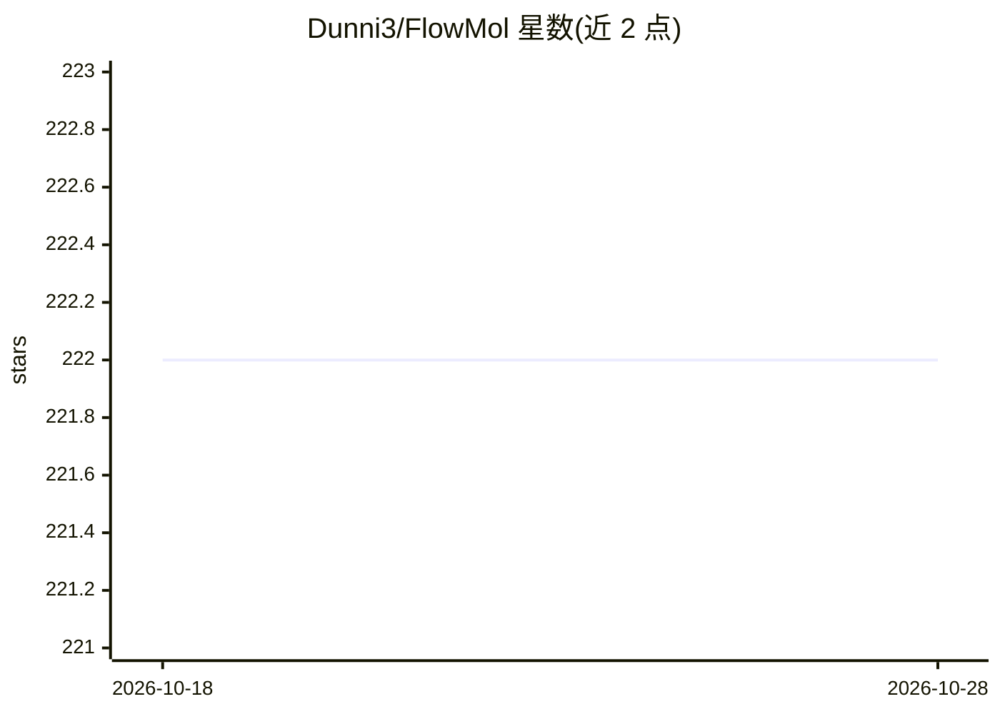

# Dunni3/FlowMol

⭐ 222 · Python · MIT · 推送 2026-04-26 · [GitHub](https://github.com/Dunni3/FlowMol) · [官网](https://arxiv.org/abs/2508.12629) · 个人维护

**面向药物设计的 3D 全新分子生成流匹配模型官方实现**

FlowMol3 的官方实现：基于混合连续/分类变量的流匹配与图神经网络，对 3D 分子做无条件全新生成，可采样生成分子并输出为 RDKit 分子或 SDF 文件。提供预训练模型加载（运行时自动下载）、test.py 采样与论文指标计算、train.py 训练、数据集处理脚本（GEOM-Drugs）及 notebook 示例。环境通过 mamba/conda 加 pip install -e . 构建，采样示例使用 .cuda() 暗示 GPU。FlowMol3 为最终版本，附 arXiv 预印本。

## 筛选速览

| 维度 | 判定 | 备注 |
|---|---|---|
| AI 角色 | `ai-native` | 本体是模型或模型工具 |
| 许可风险 | `permissive` | MIT |
| 部署形态 | `library` | 以包/库形式分发 |
| 模型依赖 | — | README 未给出锁定关系 |
| 硬件要求 | — | 无带数字的原话,不猜 |
| 安装摩擦 | `medium` | 含编译或系统依赖之一 |
| 成熟度 | — | 结构信号不足 |

## 能力要点

- 混合连续/分类流匹配的 3D 全新分子生成模型
- flowmol.load_pretrained 加载预训练模型，运行时自动下载
- test.py 支持 SDF 输出、采样轨迹与论文指标计算
- 提供 GEOM-Drugs 数据集下载与处理流程及训练脚本

## 适用场景

- 采样生成全新 3D 小分子用于药物发现研究
- 复现论文的分子生成与评测指标
- 在 GEOM-Drugs 等数据集上训练自己的生成模型

## 场景标签

 · 领域:计算化学/药物发现

## 证据(README 行号)

> L7: This is the offical implementation of FlowMol, a flow matching model for unconditional 3D de novo molecule generatio
> L46: sampled_molecules = model.sample_random_sizes(n_molecules=10, n_timesteps=250) # sample molecules

## 星数曲线

2026-10-18 222 → 2026-10-28 222（+0）

---
*卡片 v1 · prompt 1.4 · 生成 2026-10-22 · 置信度 high · 依据 README sha `a7d6b1c634c0` · [字段定义](../../DATASET.md)*
