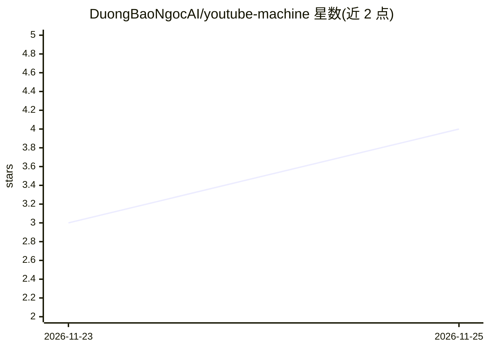

# DuongBaoNgocAI/youtube-machine

⭐ 4 · JavaScript · NOASSERTION · 推送 2026-11-22 · [GitHub](https://github.com/DuongBaoNgocAI/youtube-machine) · 组织维护

**面向 YouTube 创作者的 27 项 AI 助手技能：从选niche到发布全流程**

一组在本地 AI 助手（最佳配合 Claude Code）中运行的 27 项技能包，引导用户走完建频道全流程：选细分领域、竞品研究、关键词、品牌、脚本、AI 配音（ElevenLabs）、SRT、分镜、用 Blender 自动或 CapCut 手动渲染、SEO、发布后数据复盘。每步先问 2–5 个问题再执行，结果存入频道档案目录。技能内容经服务器"YTM 端口"下发，需用注册 Gmail 登录，每账号限 2 台机器。需 Node.js LTS 与网络连接。

## 筛选速览

| 维度 | 判定 | 备注 |
|---|---|---|
| AI 角色 | `ai-native` | 本体是模型或模型工具 |
| 许可风险 | `none` | NOASSERTION |
| 部署形态 | `None` |  |
| 模型依赖 | locked-api |  |
| 硬件要求 | — | 无带数字的原话,不猜 |
| 安装摩擦 | `medium` | 含编译或系统依赖之一 |
| 成熟度 | — | 结构信号不足 |

## 能力要点

- 27 项技能覆盖建频道到发布后数据学习的完整流程
- 每步先以 2–5 个问题确认需求再生成内容
- 支持 Blender 自动渲染与 CapCut 手动渲染两条路径
- 通过 MCP 服务器（ytm）向 Claude Code 提供工具

## 适用场景

- 从零搭建并运营一个 YouTube 频道
- 用 AI 助手批量生成脚本、配音、字幕与分镜
- 分析竞品视频的剪辑节奏与结构
- 根据真实播放数据迭代后续视频策略

## 场景标签

`AI 助手` `AI 写作` · 领域:对话与助手

## 证据(README 行号)

> L7: YouTube Machine là bộ 27 skill cho trợ lý AI chạy trên máy, dùng tốt nhất với Claude Code. Bộ skill dẫn bạn đi qua t
> L33: |7b|Giọng đọc AI (ElevenLabs), phụ đề SRT đã sửa chữ, mốc chương|`yt-07b-voice-srt`|
> L68: - Claude Code, hoặc app Claude cho máy tính (tab Code). Gemini CLI, Google Antigravity và Codex đọc được bộ skill, 

## 星数曲线

2026-11-23 3 → 2026-11-25 4（+1）

---
*卡片 v1 · prompt 1.4 · 生成 2026-11-23 · 置信度 high · 依据 README sha `51cb8ca0168c` · [字段定义](../../DATASET.md)*
