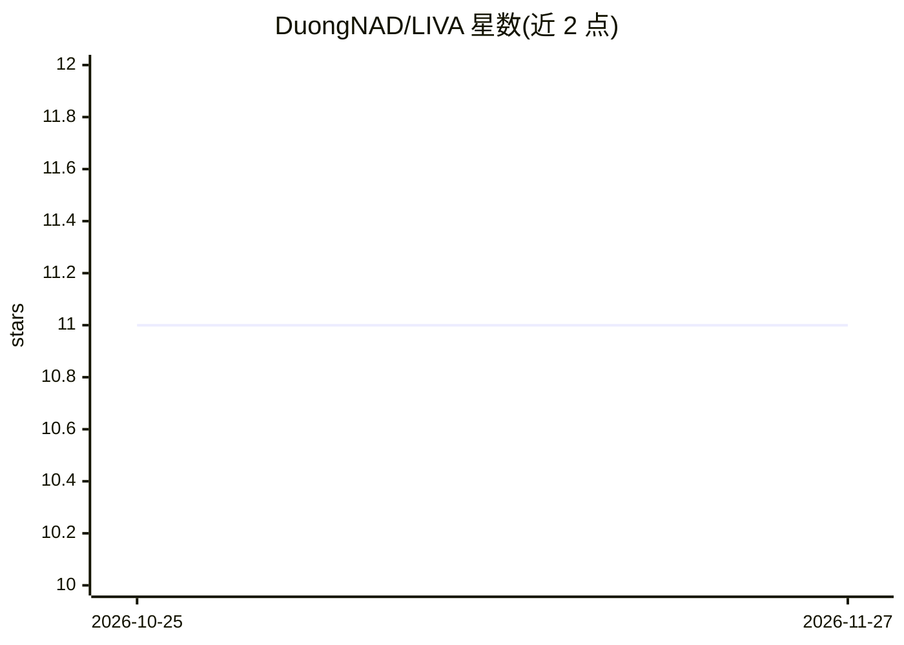

# DuongNAD/LIVA

⭐ 11 · Rust · NOASSERTION · 推送 2026-11-11 · [GitHub](https://github.com/DuongNAD/LIVA) · 个人维护

**面向 Windows 用户的 100% 本地离线桌面 AI 助手**

基于 Rust 7-crate 工作区与 Tauri v2 桌面壳的本地优先 AI 助手，在 Windows 10/11 x64 上全离线运行。整合本地 LLM 推理（Actor 模型三级优先级调度与抢占）、sqlite-vec 向量存储、Radix Trie 快速召回、HippoRAG 知识图谱、语音管线（Silero VAD/Parakeet STT/Piper TTS）、Qwen3-VL 视觉处理、91 个 MCP 工具与 Win32 桌面自动化。资源受限于 RAM ≤4GB、VRAM ≤5.1GB 的硬性上限，支持 CPU 回退推理。需从源码构建，提供 NSIS 安装包打包流程。

## 筛选速览

| 维度 | 判定 | 备注 |
|---|---|---|
| AI 角色 | `ai-native` | 本体是模型或模型工具 |
| 许可风险 | `none` | NOASSERTION |
| 部署形态 | `desktop` | 安装包/桌面程序 |
| 模型依赖 | — | README 未给出锁定关系 |
| 硬件要求 | — | 无带数字的原话,不猜 |
| 安装摩擦 | `high` | 编译与系统依赖俱全 |
| 成熟度 | — | 结构信号不足 |

## 能力要点

- 5 层记忆架构：内存 Radix Trie + SQLite WAL + sqlite-vec 向量 + HippoRAG 知识图谱
- Actor 并发模型：LLM 三级优先级队列，高优先级抢占延迟 <5ms
- 语音全栈本地处理：VAD/STT/TTS/降噪在进程内实现
- 内建硬件治理器（NVML 监控，前台高负载时自动降级后台任务）

## 适用场景

- 在不联网的前提下拥有语音/视觉/文本多模态个人助手
- 让 AI 通过 Win32 输入注入自动化操作桌面软件
- 在 16GB 内存工作站上以受限资源运行本地 LLM

## 场景标签

`AI 助手` `GUI 自动化` `多模态` · 领域:效率与自动化

## 证据(README 行号)

> L16: **LIVA** (**Local Intelligent Virtual Assistant**) is a JARVIS-like, desktop-native cognitive operating system engi
> L44: |**5. LLM Engine**|`crates/liva-llm`|2024|Actor-based local LLM runtime. Features a bounded Tokio MPSC `LlmActor` w
> L94: - **Operating System**: Windows 10/11 x64 (64-bit required).

## 星数曲线

2026-10-25 11 → 2026-11-27 11（+0）

---
*卡片 v1 · prompt 1.4 · 生成 2026-11-19 · 置信度 high · 依据 README sha `eeac30e1c9ce` · [字段定义](../../DATASET.md)*
