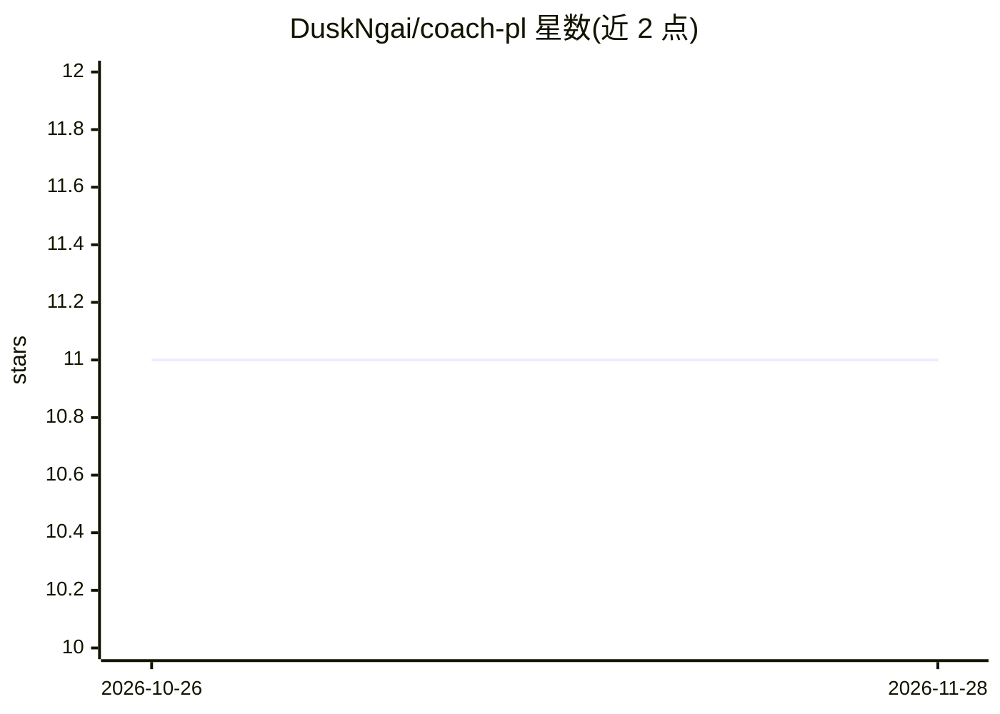

# DuskNgai/coach-pl

⭐ 11 · Python · Apache-2.0 · 推送 2026-06-02 · [GitHub](https://github.com/DuskNgai/coach-pl) · 个人维护

**面向训练与评估模型的 PyTorch-Lightning 框架**

基于 PyTorch-Lightning 的深度学习框架，用于训练与评估模型，定位为快速原型开发与实验。通过注册机制组织 criterion、dataset、sampler、transform、evaluator、model、module 等类，配合 @configurable 装饰器与 from_config 方法完成配置化，入口为 .yaml 配置文件。使用方式为 git submodule 引入，需用户自备 PyTorch 风格的 dataset/model/criterion 与 Lightning 风格 module。附带 isort、yapf、pre-commit 配置文件用于代码格式化与检查。

## 筛选速览

| 维度 | 判定 | 备注 |
|---|---|---|
| AI 角色 | `ai-native` | 本体是模型或模型工具 |
| 许可风险 | `permissive` | Apache-2.0 |
| 部署形态 | `library` | 以包/库形式分发 |
| 模型依赖 | — | README 未给出锁定关系 |
| 硬件要求 | — | 无带数字的原话,不猜 |
| 安装摩擦 | `low` | 无编译、无系统依赖或容器化 |
| 成熟度 | — | 结构信号不足 |

## 能力要点

- 注册机制 + @configurable/from_config 的配置化组件组织
- yaml 配置文件驱动训练与评估
- 以 git submodule 方式引入使用
- 附带 isort/yapf/pre-commit 格式化配置

## 适用场景

- 快速搭建模型训练与评估的实验原型
- 按 registry 结构组织自定义模型与数据组件
- 基于配置文件复用同一代码跑不同实验

## 场景标签

`模型训练` · 领域:训练与推理

## 证据(README 行号)

> L3: Coach-pl is a PyTorch-Lightning based deep learning framework for training and evaluating models.
> L31: Currently, we support `criterion`, `dataset`, (data)`sampler`, (data)`transform`, `evaluator`, `model`, and `module

## 星数曲线

2026-10-26 11 → 2026-11-28 11（+0）

---
*卡片 v1 · prompt 1.4 · 生成 2026-11-19 · 置信度 low · 依据 README sha `7af2c0a126c9` · [字段定义](../../DATASET.md)*
