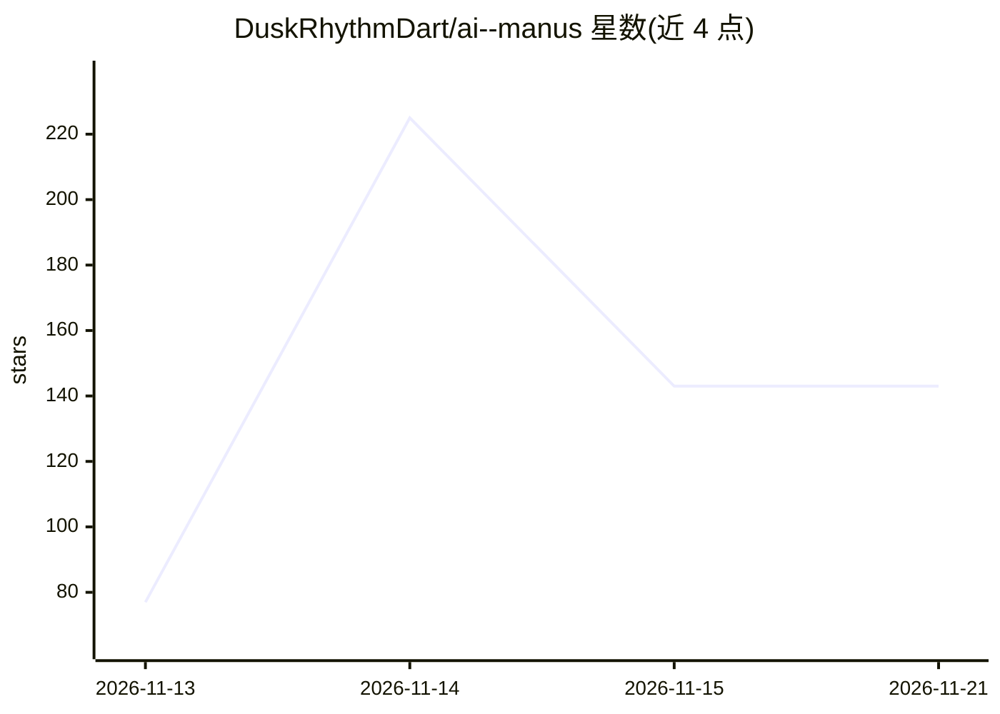

# DuskRhythmDart/ai--manus

⭐ 143 · Apache-2.0 · 推送 2026-11-15 · [GitHub](https://github.com/DuskRhythmDart/ai--manus) · 个人维护

**面向个人用户的自主 AI Agent：代写代码并控制浏览器**

Manus 是一个自主 AI Agent 系统，面向家庭、学习与轻量办公场景的用户。用户以自然语言下达指令，Agent 可编写并执行脚本、打开网页、操作页面元素、执行多步骤任务；代码执行与浏览器控制可在同一流程中衔接。README 描述其定位为非企业级的小型助手，可在后台待命处理重复性事务。README 未提供具体的安装命令、模型接入方式或代码结构说明，仅给出使用步骤与硬件兼容性表格。

## 筛选速览

| 维度 | 判定 | 备注 |
|---|---|---|
| AI 角色 | `ai-native` | 本体是模型或模型工具 |
| 许可风险 | `permissive` | Apache-2.0 |
| 部署形态 | `None` |  |
| 模型依赖 | — | README 未给出锁定关系 |
| 硬件要求 | — | 无带数字的原话,不猜 |
| 安装摩擦 | `low` | 无编译、无系统依赖或容器化 |
| 成熟度 | — | 结构信号不足 |

## 能力要点

- 自主编写并执行代码完成任务
- 浏览器控制：导航网页、填表、收集信息
- 代码与浏览器操作在同一工作流中衔接
- 面向小型任务，可在后台持续待命

## 适用场景

- 让 Agent 代为查网页、填表和收集资料
- 用自然语言驱动脚本执行日常小任务
- 学习与家庭项目中处理重复性事务

## 场景标签

`浏览器自动化` · 领域:效率与自动化

## 证据(README 行号)

> L10: - **Autonomous Code Execution:** Manus AI agent runs code on its own to complete tasks, so you can focus on decisio
> L18: Manus is an autonomous AI agent designed to run code and control a browser on your behalf. Instead of acting like a

## 星数曲线

2026-11-13 77 → 2026-11-21 143（+66）

---
*卡片 v1 · prompt 1.4 · 生成 2026-11-17 · 置信度 low · 依据 README sha `0f78ee3a5dd2` · [字段定义](../../DATASET.md)*
