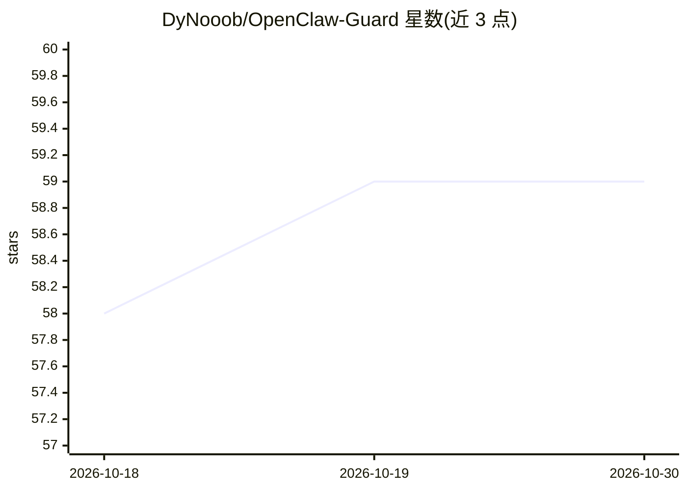

# DyNooob/OpenClaw-Guard

⭐ 59 · Python · Apache-2.0 · 推送 2026-06-29 · [GitHub](https://github.com/DyNooob/OpenClaw-Guard) · 个人维护 · 中文 README

**OpenClaw 非侵入式安全客户端：Hook 审批、基线扫描与审计**

面向 OpenClaw agent 的本地安全增强客户端与控制面前端：在不修改 OpenClaw 源码的前提下，通过原生 Hook 接入 before_tool_call/after_tool_call，对删除、写入、外联等危险动作做执行前判定（allow/ask/block/escalate）与审批；内置基线扫描（配置、运行用户、网络暴露、依赖），输出 JSON/HTML/PDF 报告与整改脚本，并以 SQLite+JSONL 双写审计支持导出。前端提供对话、模型切换、技能与渠道管理。运行依赖 Python 3.13+、Node.js 与已运行的 OpenClaw Gateway；ptrace/eBPF 仅为能力预留。README 顶部声明项目暂时搁置。

## 筛选速览

| 维度 | 判定 | 备注 |
|---|---|---|
| AI 角色 | `ai-ecosystem` | LLM/agent 周边工具 |
| 许可风险 | `permissive` | Apache-2.0 |
| 部署形态 | `self-host` | docker 或自建部署 |
| 模型依赖 | — | README 未给出锁定关系 |
| 硬件要求 | — | 无带数字的原话,不猜 |
| 安装摩擦 | `low` | 无编译、无系统依赖或容器化 |
| 成熟度 | — | 结构信号不足 |

## 能力要点

- 非侵入式接入：不改 OpenClaw 源码，经原生 Hook 与 Gateway RPC 联动
- 执行前风险控制 allow/ask/block/escalate，高风险动作需人工确认
- 基线扫描输出 JSON/HTML/PDF 报告与整改脚本
- SQLite+JSONL 双写审计，支持 JSON/CSV 导出

## 适用场景

- 高安全终端或内网环境给 OpenClaw 加执行前审批
- 对 OpenClaw 配置与运行状态做基线扫描与整改
- 本地集中管理 OpenClaw 会话、技能与审计日志

## 场景标签

`网络安全` · 领域:学习与行业

## 证据(README 行号)

> L5: Openclaw Guard（龙虾卫士）是一个面向 OpenClaw 的非侵入式安全增强客户端与本地控制面。
> L7: 项目目标不是替换 OpenClaw，而是在**不修改 OpenClaw 源码**的前提下，使用Hook技术，为 OpenClaw 增加更清晰的安全交互、更可控的执行前审批、更完整的基线扫描与审计能力，并把这些能力集中到一个可直接使用
> L79: 2. Guard 将本地 Hook 插件写入 OpenClaw 配置，并通过 OpenClaw 官方插件机制接入 `before_tool_call` / `after_tool_call`

## 星数曲线

2026-10-18 58 → 2026-10-30 59（+1）

---
*卡片 v1 · prompt 1.4 · 生成 2026-10-24 · 置信度 mid · 依据 README sha `1ac8201c15d8` · [字段定义](../../DATASET.md)*
