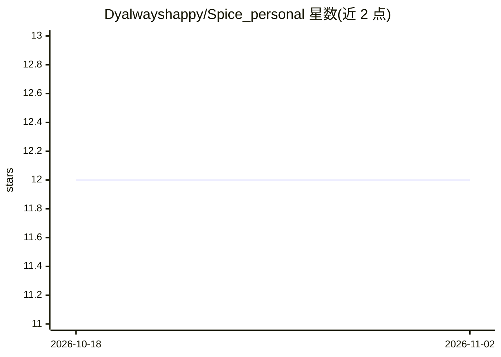

# Dyalwayshappy/Spice_personal

⭐ 12 · Python · NOASSERTION · 推送 2026-04-10 · [GitHub](https://github.com/Dyalwayshappy/Spice_personal) · 个人维护

**个人 AI 决策助手参考应用：帮你思考并决定下一步行动**

构建在 Spice Runtime 之上的参考应用与 CLI，定位为决策层：用户以自然语言提出意图（ask 命令），系统生成 Decision Card 形式的决策输出。模型需在 .spice/personal/personal.config.json 中自行配置（示例为 OpenRouter 并设置 API key）。可选开启交互式 session 模式，并可接入外部 agent（当前提供 CodeX 与 ClaudeCode 的 wrapper）以收集现实证据、执行任务，形成决策到行动的闭环。通过 PyPI 安装会自动附带 spice-runtime，也可克隆源码开发。

## 筛选速览

| 维度 | 判定 | 备注 |
|---|---|---|
| AI 角色 | `ai-native` | 本体是模型或模型工具 |
| 许可风险 | `none` | NOASSERTION |
| 部署形态 | `library` | 以包/库形式分发 |
| 模型依赖 | — | README 未给出锁定关系 |
| 硬件要求 | — | 无带数字的原话,不猜 |
| 安装摩擦 | `low` | 无编译、无系统依赖或容器化 |
| 成熟度 | — | 结构信号不足 |

## 能力要点

- CLI 命令 ask/init/session 生成 Decision Card 形式的决策
- 可配置模型提供方（如 OpenRouter）并使用自有 API key
- 可委派行动给外部 agent（CodeX、ClaudeCode wrapper），闭环决策到执行
- pip 安装自动附带 spice-runtime 依赖

## 适用场景

- 用自然语言向助手征询下一步行动的决策建议
- 让决策助手检索信息并调用外部工具执行任务
- 作为 Spice Runtime 的参考实现进行开发体验

## 场景标签

`AI 助手` · 领域:对话与助手

## 证据(README 行号)

> L15: It helps you think through decisions — and optionally take action via external agents.
> L68: spice-personal ask "What should I do next?"

## 星数曲线

2026-10-18 12 → 2026-11-02 12（+0）

---
*卡片 v1 · prompt 1.4 · 生成 2026-11-01 · 置信度 high · 依据 README sha `a339f3f441b6` · [字段定义](../../DATASET.md)*
