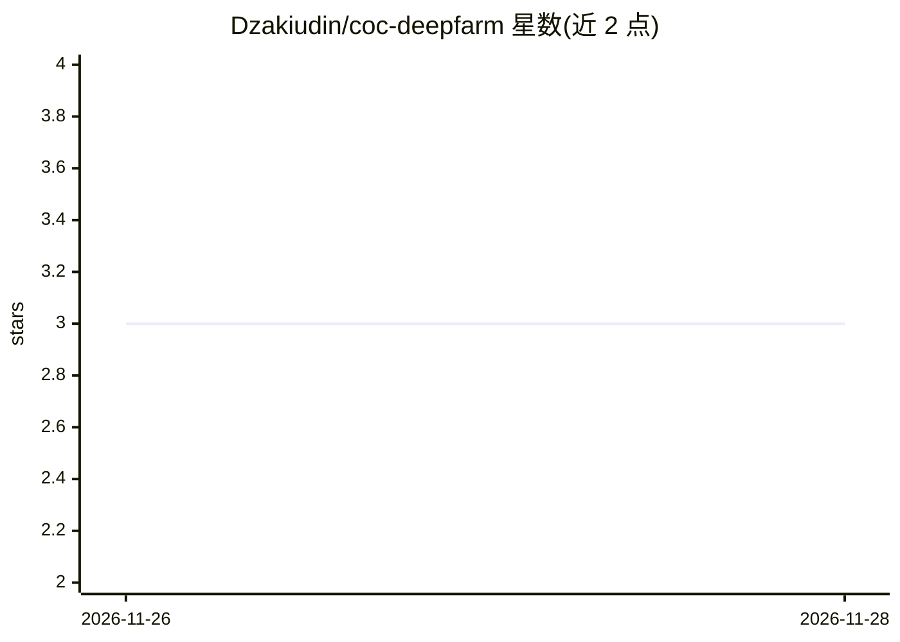

# Dzakiudin/coc-deepfarm

⭐ 3 · Python · MIT · 推送 2026-11-06 · [GitHub](https://github.com/Dzakiudin/coc-deepfarm) · 个人维护

**用双脑深度学习自动刷部落冲突资源的游戏机器人**

面向 Clash of Clans 玩家的自动化耕作机器人：通过 ADB 后台读取 20 FPS H.264 视频流并执行多点触控，用自建 PyTorch 网络（CoCCommanderNet 宏策略 + AttackPolicyNet 微操作）决策出兵，配合 YOLOv8 检测资源建筑、EasyOCR 识别、k-NN 基地记忆库复用成功战术，并以在线强化学习自我改进。支持录制 .mp4 视频做行为克隆训练，GUI 提供战术雷达与学习曲线，Windows 一键脚本自动配置 .venv 与 CUDA/CPU 依赖。

## 筛选速览

| 维度 | 判定 | 备注 |
|---|---|---|
| AI 角色 | `ai-native` | 本体是模型或模型工具 |
| 许可风险 | `permissive` | MIT |
| 部署形态 | `None` |  |
| 模型依赖 | — | README 未给出锁定关系 |
| 硬件要求 | — | 无带数字的原话,不猜 |
| 安装摩擦 | `medium` | 含编译或系统依赖之一 |
| 成熟度 | — | 结构信号不足 |

## 能力要点

- 双脑 PyTorch 网络：CoCCommanderNet 宏策略 + AttackPolicyNet 点击轨迹，GPU 上推理 <1ms
- k-NN 基地记忆库存 512 个阵型，自动复用成功战术并规避失败路线
- 在线强化学习：每波评估战利品并反传，256 回合经验回放
- ADB 后台运行：20 FPS 视频流与多点触控，可最小化模拟器窗口

## 适用场景

- 挂机自动刷金矿与圣水资源
- 用自己的攻击录像训练个性化出兵策略
- 后台最小化运行不占用桌面

## 场景标签

`强化学习` `目标检测` · 领域:感知与多模态

## 证据(README 行号)

> L3: **100% Dedicated Clash of Clans Dual-Brain Deep Learning & Online Reinforcement Learning Bot**
> L29: |🧠 **Dual-Brain PyTorch AI (`< 1 ms` on GPU)**|Replaces slow, rate-limited external text LLMs with two purpose-buil
> L47: |**4. Computer Vision**|`perception/vision.py`, `perception/template_matcher.py`|Ultralytics YOLO storage detector,

## 星数曲线

2026-11-26 3 → 2026-11-28 3（+0）

---
*卡片 v1 · prompt 1.4 · 生成 2026-11-26 · 置信度 high · 依据 README sha `b771deddba15` · [字段定义](../../DATASET.md)*
