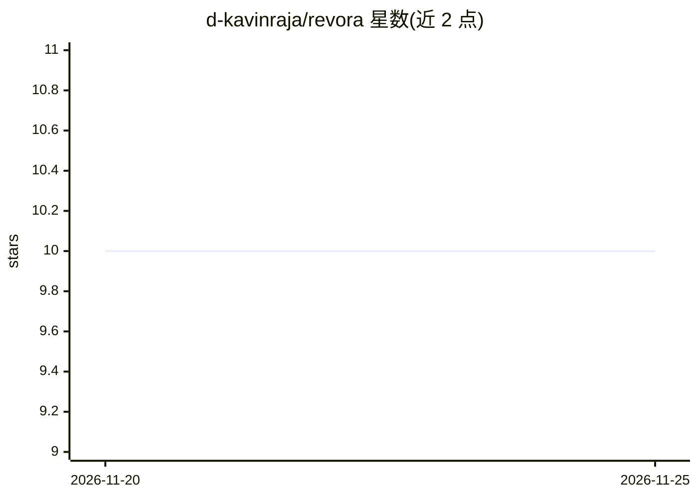

# d-kavinraja/revora

⭐ 10 · Python · MIT · 推送 2026-11-23 · [GitHub](https://github.com/d-kavinraja/revora) · [官网](https://revora-pr.vercel.app/) · 个人维护

**自托管 AI 代码审查平台：PR 时先建全仓索引再产出审查意见**

面向自托管部署的 GitHub 原生代码审查平台：PR 事件经 HMAC 校验的 webhook 触发，克隆仓库并构建全仓索引（17 个检测器、8 类代码图），检索与 diff 相关文件进入提示词，再经验证引擎对每条发现复检并打上 Machine Verified 标记，结果以 PR 评论与仪表盘呈现。通过 LiteLLM 路由多提供商，自带密钥（BYOK）加密存储；审查历史、成本与 token 用量持久化在 PostgreSQL。Docker Compose 为受支持部署路径，项目处于 pre-release 阶段。

## 筛选速览

| 维度 | 判定 | 备注 |
|---|---|---|
| AI 角色 | `ai-native` | 本体是模型或模型工具 |
| 许可风险 | `permissive` | MIT |
| 部署形态 | `self-host` | docker 或自建部署 |
| 模型依赖 | local-ok | 支持本地模型 |
| 硬件要求 | — | 无带数字的原话,不猜 |
| 安装摩擦 | `low` | 无编译、无系统依赖或容器化 |
| 成熟度 | `idea` | |

## 能力要点

- 全仓索引（17 检测器 + 代码图）检索 diff 相关文件后再审查
- 验证引擎复检 AI 发现并打 Machine Verified 标记
- BYOK：密钥加密存储、按提供商/模型路由，无托管密钥
- 审查进度经 SSE 实时流式展示，用量与成本持久化

## 适用场景

- 在自托管环境中对 GitHub PR 产出基于代码库上下文的审查意见
- 用自有 LLM API key 运行团队代码审查流水线
- 在仪表盘跟踪审查历史、成本与 token 用量

## 场景标签

`代码审查` `RAG` · 领域:编码与开发

## 证据(README 行号)

> L14: Revora is an open-source, self-hosted AI code review platform. On every pull request, it clones the repo, builds a 
> L95: Providers are configured in-app with your own keys and routed through LiteLLM — no Revora-hosted keys, no fallback 

## 星数曲线

2026-11-20 10 → 2026-11-25 10（+0）

---
*卡片 v1 · prompt 1.4 · 生成 2026-11-20 · 置信度 high · 依据 README sha `fcef2d49c177` · [字段定义](../../DATASET.md)*
