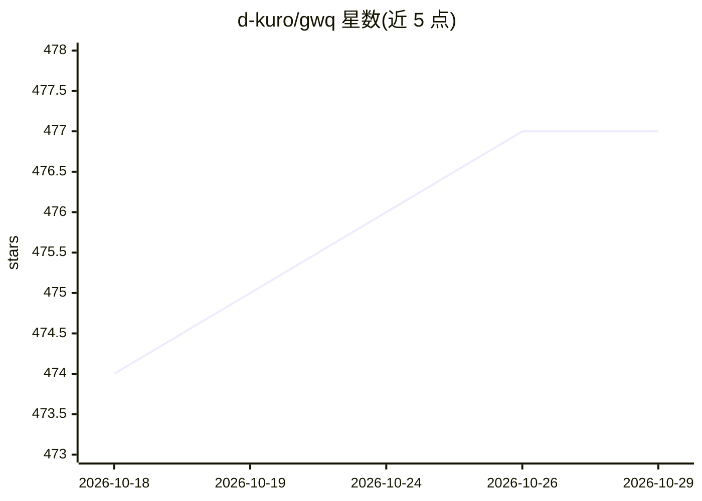

# d-kuro/gwq

⭐ 477 · Go · Apache-2.0 · 推送 2026-10-02 · [GitHub](https://github.com/d-kuro/gwq) · 个人维护

**带模糊查找的 Git worktree 管理 CLI，支持并行 AI 编码工作流**

Go 编写的命令行工具，用于创建、切换、删除 Git worktree，操作通过内置模糊查找界面完成。支持跨仓库的全局 worktree 管理（基于文件系统扫描，无需注册表）、状态仪表盘、tmux 会话管理、Shell 补全与集成、按仓库配置文件复制与 setup 命令（Go text/template 渲染后经 sh -c 执行）。面向开发者，README 将并行运行多个 AI 编码 agent 列为主要使用场景：每个 worktree 目录隔离，多个 agent 可同时工作而不产生合并冲突。安装途径为 Homebrew、go install 或源码构建，要求 Git 2.5+。

## 筛选速览

| 维度 | 判定 | 备注 |
|---|---|---|
| AI 角色 | `ai-enhanced` | 去掉 AI 部分产品仍成立 |
| 许可风险 | `permissive` | Apache-2.0 |
| 部署形态 | `library` | 以包/库形式分发 |
| 模型依赖 | — | README 未给出锁定关系 |
| 硬件要求 | — | 无带数字的原话,不猜 |
| 安装摩擦 | `low` | 无编译、无系统依赖或容器化 |
| 成熟度 | — | 结构信号不足 |

## 能力要点

- 模糊查找界面完成分支与 worktree 选择
- 跨仓库全局 worktree 管理，文件系统扫描无需注册表
- tmux 集成管理与运行长时进程
- 按仓库的 copy_files / setup_commands 自动化配置

## 适用场景

- 在同一仓库同时检出多个分支并行开发
- 让多个 AI 编码 agent 在隔离目录中并行处理不同任务
- 统一查看所有 worktree 的 git 状态与变更

## 场景标签

 · 领域:开发者工具/Git

## 证据(README 行号)

> L10: - Running parallel AI coding agents on different tasks
> L16: One of the most powerful applications of `gwq` is enabling parallel AI coding workflows. Instead of having a single
> L351: For a powerful development workflow, you can integrate `gwq` with ghq (repository manager) and fzf (fuzzy finder).

## 星数曲线

2026-10-18 474 → 2026-10-29 477（+3）

---
*卡片 v1 · prompt 1.4 · 生成 2026-10-21 · 置信度 low · 依据 README sha `9865254170a0` · [字段定义](../../DATASET.md)*
