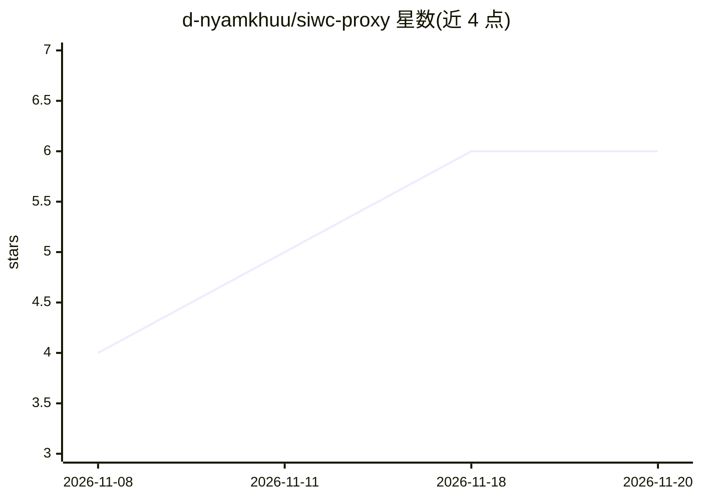

# d-nyamkhuu/siwc-proxy

⭐ 6 · Python · MIT · 推送 2026-11-16 · [GitHub](https://github.com/d-nyamkhuu/siwc-proxy) · 个人维护

**本地 OpenAI 兼容代理：用 ChatGPT 登录凭证供任意 SDK 调用**

本地运行的 OpenAI 兼容 API 代理，基于 Sign in with ChatGPT token sharing：用户登录一次后，代理自动维护凭证刷新（跨进程文件锁、401 重试），并向任何可设 base_url 的 OpenAI SDK/框架/工具提供 /v1/chat/completions、/v1/responses、/v1/models 端点。Chat Completions 请求被翻译为 Responses，错误映射为 OpenAI 错误格式。仅限个人本地使用，不支持公开托管；ChatGPT 后端为 preview，可能变更。通过 uv/pip/pipx 安装为 Python 命令行工具。

## 筛选速览

| 维度 | 判定 | 备注 |
|---|---|---|
| AI 角色 | `ai-ecosystem` | LLM/agent 周边工具 |
| 许可风险 | `permissive` | MIT |
| 部署形态 | `library` | 以包/库形式分发 |
| 模型依赖 | — | README 未给出锁定关系 |
| 硬件要求 | — | 无带数字的原话,不猜 |
| 安装摩擦 | `low` | 无编译、无系统依赖或容器化 |
| 成熟度 | `idea` | |

## 能力要点

- 自动处理 OAuth 登录、PKCE 校验与轮换 refresh token 刷新
- 提供 /v1/chat/completions、/v1/responses、/v1/models 兼容端点
- 错误映射为 OpenAI 格式（如计划限额返回 429），客户端退避逻辑可直接使用
- 支持远程无浏览器机器的 --remote 登录流程与多凭证目录

## 适用场景

- 在本地脚本或工具中用 OpenAI SDK 调用自己的 ChatGPT 计划
- 给不支持 ChatGPT 登录的第三方工具接入本地代理端点
- 多账户场景下用 --data-dir 分别管理凭证

## 场景标签

`模型网关` · 领域:Agent 开发

## 证据(README 行号)

> L3: A local **OpenAI-compatible API** backed by
> L6: `/v1/chat/completions`, `/v1/responses`, and `/v1/models` to any OpenAI SDK,

## 星数曲线

2026-11-08 4 → 2026-11-20 6（+2）

---
*卡片 v1 · prompt 1.4 · 生成 2026-11-20 · 置信度 high · 依据 README sha `4fa46facfcae` · [字段定义](../../DATASET.md)*
