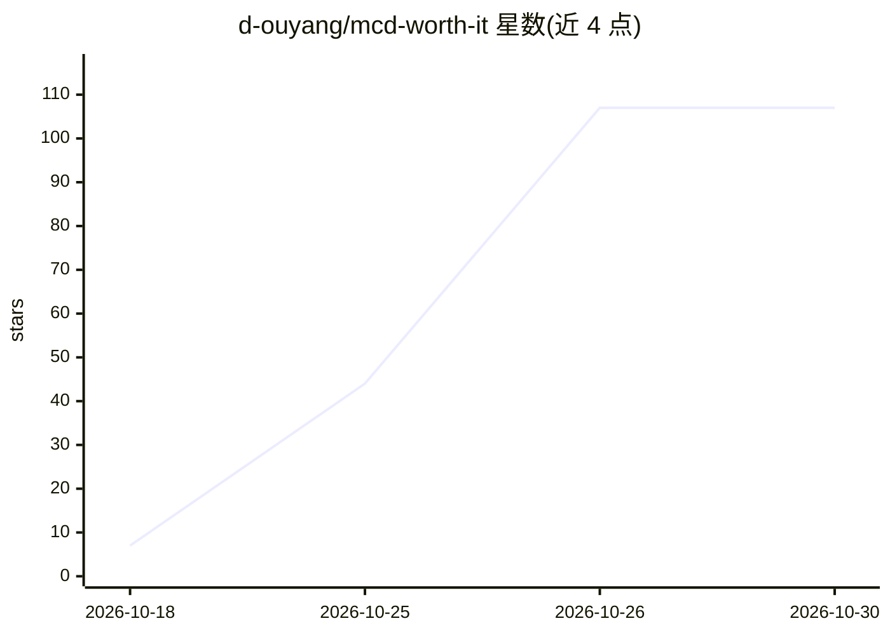

# d-ouyang/mcd-worth-it

⭐ 107 · HTML · MIT · 推送 2026-10-13 · [GitHub](https://github.com/d-ouyang/mcd-worth-it) · [官网](https://github.com/d-ouyang/mcd-worth-it/) · 个人维护 · 中文 README

**麦当劳 MCP 权益精算 Skill：按档口与账户权益实时核价点单**

面向麦当劳中国大陆会员的 agent 技能包（SKILL.md 形式），运行于 WorkBuddy 及其他支持 MCP 的客户端，数据来自官方 mcd-mcp 接口（open.mcd.cn/mcp 申请 Token）。三层能力：按档口×履约方式出带账点单推荐、早餐卡/麦金卡回本与办卡决策、主题派对与积分兑换计算；本地存储账本与偏好记忆，写操作前逐项确认。数字由核价接口实时返回，非估算。安装方式为 git clone 后以目录为工作目录加载，非麦当劳官方产品，为参赛作品。

## 筛选速览

| 维度 | 判定 | 备注 |
|---|---|---|
| AI 角色 | `ai-native` | 本体是模型或模型工具 |
| 许可风险 | `permissive` | MIT |
| 部署形态 | `None` |  |
| 模型依赖 | — | README 未给出锁定关系 |
| 硬件要求 | — | 无带数字的原话,不猜 |
| 安装摩擦 | `low` | 无编译、无系统依赖或容器化 |
| 成熟度 | — | 结构信号不足 |

## 能力要点

- 档口感知 × 自提/外送双方案的带账点单推荐
- 早餐卡回本进度与麦金卡办卡决策计算，数字来自核价接口实时返回
- 实付账本与偏好写入本地记忆库，不上传
- 下单等写操作前逐项确认，不静默消费

## 适用场景

- 买了早餐卡/麦金卡想算清回本与每单省多少
- 点单时让 AI 直接给出带账的最划算方案
- 预订早餐、主题派对或查询积分兑换性价比

## 场景标签

`AI 助手` `数据分析` · 领域:效率与自动化

## 证据(README 行号)

> L101: - 麦当劳中国大陆会员，并在 open.mcd.cn/mcp 申请到 **MCP Token**（本 Skill 的全部数据都来自这个官方接口）
> L161: - 麦当劳官方 MCP Server（`https://mcp.mcd.cn`），20 个工具编排，详见 MCP_INTEGRATION.md

## 星数曲线

2026-10-18 7 → 2026-10-30 107（+100）

---
*卡片 v1 · prompt 1.4 · 生成 2026-10-25 · 置信度 high · 依据 README sha `01b5b227db18` · [字段定义](../../DATASET.md)*
