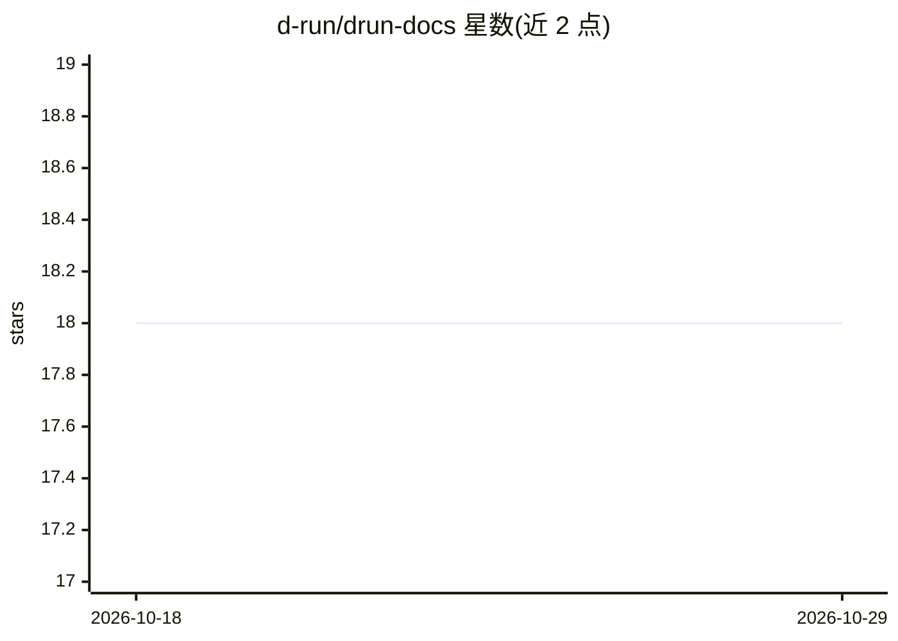

# d-run/drun-docs

⭐ 18 · HTML · 推送 2026-10-28 · [GitHub](https://github.com/d-run/drun-docs) · [官网](https://docs.d.run) · 组织维护 · 中文 README

**d.run AIGC 平台的官方文档站仓库**

本仓库是 DaoCloud 旗下 d.run AIGC 平台的用户文档门户，汇集平台相关文档页面。文档介绍 d.run 平台整合云原生 AI 引擎、DataTunerX、DaoCloud AIGC Knowledge、infmonkeys 等生成引擎与插件，用于创建、训练和推理 AI 产品并利用组织知识库。仓库本身基于 MkDocs 构建静态网站，通过 PR 流程修改、翻译和管理页面，支持 Docker（make serve）或 Poetry+Python 3.9+ 本地预览，并规定了文件命名与写作规范。

## 筛选速览

| 维度 | 判定 | 备注 |
|---|---|---|
| AI 角色 | `ai-knowledge` | 知识聚合/清单类 |
| 许可风险 | `none` | — |
| 部署形态 | `None` |  |
| 模型依赖 | — | README 未给出锁定关系 |
| 硬件要求 | — | 无带数字的原话,不猜 |
| 安装摩擦 | `low` | 无编译、无系统依赖或容器化 |
| 成熟度 | — | 结构信号不足 |

## 能力要点

- d.run 平台全部文档的统一入口与 PR 协作流程
- 整合云原生 AI 引擎、DataTunerX、AIGC Knowledge、infmonkeys 等组件的介绍
- 提供 MkDocs 文档站的 Docker 与 Poetry 两种本地预览方式
- 规定文件命名与中英文混排写作规范

## 适用场景

- 查阅 d.run 平台的使用文档
- 通过 PR 参与文档的修改、翻译与维护
- 本地预览并验证文档站修改效果

## 场景标签

 · 领域:AI 平台文档/MLOps

## 证据(README 行号)

> L10: d.run is a comprehensive AIGC platform that allows you to enhance your LLM models and
> L12: such as cloud native AI engine, DataTunerX, DaoCloud AIGC Knowledge, and infmonkeys,
> L13: d.run provides a powerful tool for creating, training, and inferring AI products.

## 星数曲线

2026-10-18 18 → 2026-10-29 18（+0）

---
*卡片 v1 · prompt 1.4 · 生成 2026-10-29 · 置信度 mid · 依据 README sha `e61ab9ae694f` · [字段定义](../../DATASET.md)*
