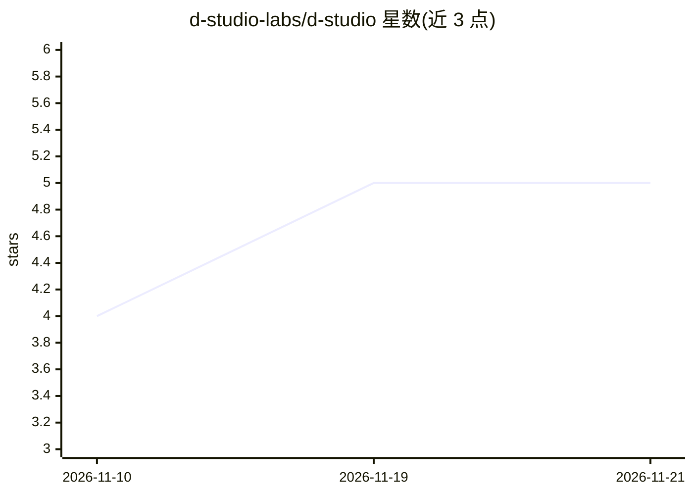

# d-studio-labs/d-studio

⭐ 5 · JavaScript · AGPL-3.0 · 推送 2026-11-14 · [GitHub](https://github.com/d-studio-labs/d-studio) · 组织维护

**以代码写音乐的音乐框架：JS 定义曲目，SuperDirt 发声**

D-Studio 是一个“以代码写音乐”的框架：曲目是定义 BPM 与 parts 的 JS 文件，引擎调度 parts 并发送给 SuperCollider 的 SuperDirt 发声，同一曲目可渲染为 WAV、检查静音部分或在浏览器中显示。播放中保存被导入的文件可不停表热替换 pattern。支持自定义 SynthDef、加载自定义采样（内置 TR-909/TR-808 下载）、USB MIDI 控制器接入（内置 Arturia MiniLab mkII 映射）。通过 curl 脚本脚手架创建项目，包发布在 GitHub Packages（需 read:packages token）。

## 筛选速览

| 维度 | 判定 | 备注 |
|---|---|---|
| AI 角色 | `ai-enhanced` | 去掉 AI 部分产品仍成立 |
| 许可风险 | `viral` | AGPL-3.0 |
| 部署形态 | `library` | 以包/库形式分发 |
| 模型依赖 | — | README 未给出锁定关系 |
| 硬件要求 | — | 无带数字的原话,不猜 |
| 安装摩擦 | `low` | 无编译、无系统依赖或容器化 |
| 成熟度 | `idea` | |

## 能力要点

- JS 文件定义曲目，pattern 播放中保存即热替换、时钟不停
- 自定义 SuperCollider SynthDef 与采样文件夹即声音源
- USB MIDI 控制器即插即用，旋钮/按键映射到 pattern 参数
- 浏览器 spatial 视图：环绕声场点云可视化与遮蔽提示

## 适用场景

- 用 JS 编写并现场修改电子音乐 pattern
- 把曲目导出为 WAV 文件
- 连接 MIDI 控制器实时控制滤波器等参数
- 可视化查看各声部在环绕声场中的位置

## 场景标签

 · 领域:音乐/创意编程工具

## 证据(README 行号)

> L3: CI
> L7: D-Studio is a framework for writing music as code. A track is a JS file

## 星数曲线

2026-11-10 4 → 2026-11-21 5（+1）

---
*卡片 v1 · prompt 1.4 · 生成 2026-11-21 · 置信度 low · 依据 README sha `baa908a9129d` · [字段定义](../../DATASET.md)*
