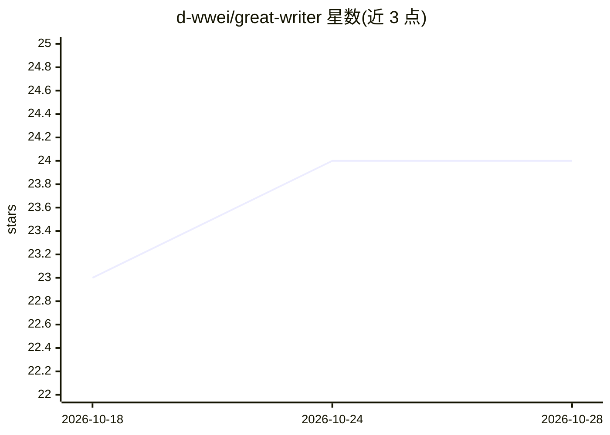

# d-wwei/great-writer

⭐ 24 · Shell · MIT · 推送 2026-04-14 · [GitHub](https://github.com/d-wwei/great-writer) · 个人维护 · 中文 README

**装在 AI agent 上的写作技能：9 模式 6 阶段管线产出去 AI 腔文稿**

以 SKILL.md 技能目录（约 20 个文件）或单文件打包形式安装到任意支持加载技能/系统提示的 AI agent（Claude Code、Codex、Cursor、Windsurf、Gemini CLI 等）。核心机制：写前强制研究并产出 Research Summary，用四种"铲子"挖掘核心观点并压力测试；随后按 6 阶段（核心逻辑→结构→草稿→评审→润色→定稿）执行，含 4 轮润色（口语测试、密度压缩、双语黑名单去 AI 痕迹、反风格检查）、9 种写作模式、15 条可机械校验的写作原则。限制：依赖宿主 agent 运行，非独立产品。

## 筛选速览

| 维度 | 判定 | 备注 |
|---|---|---|
| AI 角色 | `ai-native` | 本体是模型或模型工具 |
| 许可风险 | `permissive` | MIT |
| 部署形态 | `None` |  |
| 模型依赖 | — | README 未给出锁定关系 |
| 硬件要求 | — | 无带数字的原话,不猜 |
| 安装摩擦 | `low` | 无编译、无系统依赖或容器化 |
| 成熟度 | — | 结构信号不足 |

## 能力要点

- 9 种写作模式（技术文章、营销文案、小红书笔记、研究报告等）
- 6 阶段写作管线：研究→找核心→结构→草稿→评审→润色→定稿
- 4 轮润色含双语 AI 痕迹黑名单（30+ 禁用短语）与 8 种结构模式检测
- 按需加载模块：风格学习、8+ 平台改编、跨会话写作记忆、SEO/GEO

## 适用场景

- 让我的 AI agent 写出不像 AI 生成的公众号文章或营销文案
- 写前先做受众研究和核心观点压力测试，而非直接生成
- 同一篇内容一键改编成小红书、Twitter 等 8+ 平台版本

## 场景标签

`AI 写作` `提示工程` · 领域:Agent 开发

## 证据(README 行号)

> L5: A writing system for AI agents. Not a prompt template — a 6-phase pipeline that forces your agent to think before it
> L27: Great Writer is a single skill you install on any AI agent (Claude Code, Codex, Cursor, Windsurf, Gemini CLI — anyt

## 星数曲线

2026-10-18 23 → 2026-10-28 24（+1）

---
*卡片 v1 · prompt 1.4 · 生成 2026-10-27 · 置信度 high · 依据 README sha `825c449d4e1f` · [字段定义](../../DATASET.md)*
