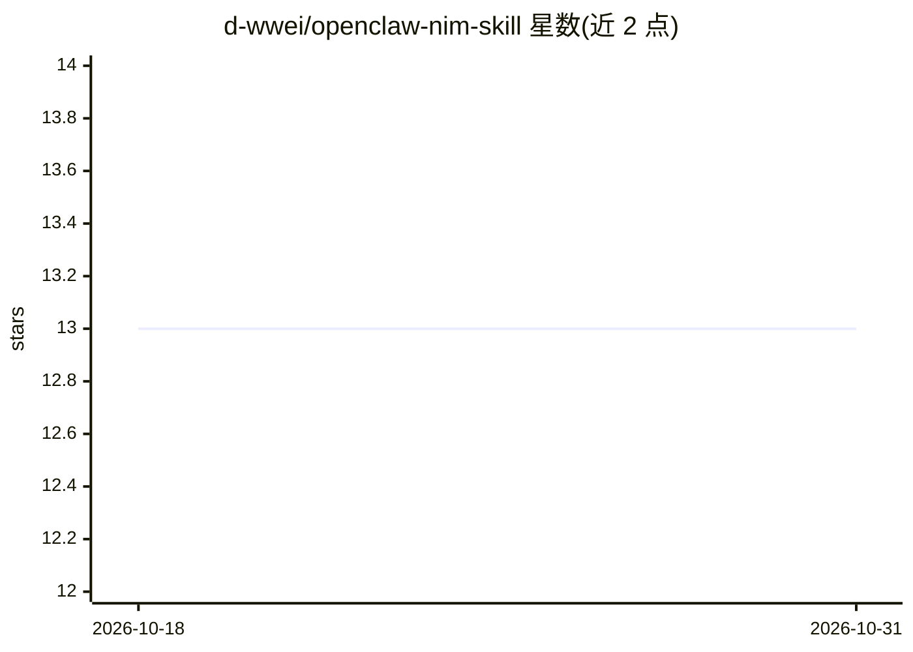

# d-wwei/openclaw-nim-skill

⭐ 13 · Python · 推送 2026-02-23 · [GitHub](https://github.com/d-wwei/openclaw-nim-skill) · 个人维护 · 中文 README

**OpenClaw 技能：把重任务外包给 NVIDIA NIM 模型以节省上下文 token**

一个 OpenClaw/Claude Code 的 SKILL 插件，接入 NVIDIA NIM 推理服务，将摘要、长文解释、深度推理等重任务转交给 GLM-5、Kimi-k2.5、DeepSeek R1 等模型处理，从而减少主 agent 会话的上下文 token 消耗（README 称最多节省 90%+）。纯 Python 实现仅用 urllib，无第三方依赖；需从 NVIDIA Build 获取免费 API Key 并配置环境变量。安装方式为克隆仓库到 skills/ 目录，支持会话内 /nim 命令与命令行脚本两种用法。

## 筛选速览

| 维度 | 判定 | 备注 |
|---|---|---|
| AI 角色 | `ai-ecosystem` | LLM/agent 周边工具 |
| 许可风险 | `none` | — |
| 部署形态 | `None` |  |
| 模型依赖 | — | README 未给出锁定关系 |
| 硬件要求 | — | 无带数字的原话,不猜 |
| 安装摩擦 | `low` | 无编译、无系统依赖或容器化 |
| 成熟度 | — | 结构信号不足 |

## 能力要点

- 将摘要/长解释/推理任务外包给 NVIDIA NIM 平台模型
- 纯 Python urllib 实现，零第三方依赖
- 支持在多个模型间切换（GLM-5、Kimi-k2.5、DeepSeek R1 等）

## 适用场景

- 主 agent 上下文紧张时，把长文本处理任务转交外部模型
- 在 OpenClaw 会话中用 /nim 命令调用 NIM 模型做摘要
- 通过 CLI 脚本直接调用 NIM 模型

## 场景标签

`模型网关` · 领域:Agent 开发

## 证据(README 行号)

> L3: 🚀 **Token-Saving Superpower for OpenClaw/Claude Code**
> L5: This skill integrates the **NVIDIA NIM (Inference Microservices)** platform into your OpenClaw environment. It allow

## 星数曲线

2026-10-18 13 → 2026-10-31 13（+0）

---
*卡片 v1 · prompt 1.4 · 生成 2026-10-31 · 置信度 high · 依据 README sha `c107ce14cf3f` · [字段定义](../../DATASET.md)*
