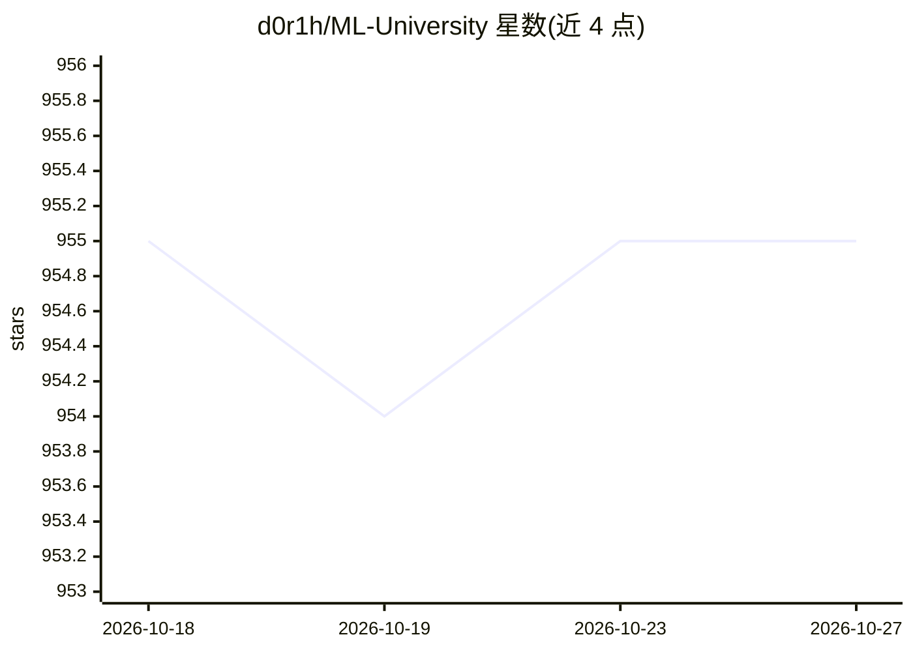

# d0r1h/ML-University

⭐ 955 · 推送 2026-10-12 · [GitHub](https://github.com/d0r1h/ML-University) · 个人维护

**面向 ML 学习者的免费开放课程与资源清单**

由 ML 爱好者维护的免费机器学习大学式资源清单：按 18 个章节组织，收录数学、机器学习、深度学习、NLP、强化学习、LLM、生成式与 Agentic AI 等主题的公开课程（MIT/Stanford/CMU 等）、书籍、数据集、必读论文（NLP/OCR/LLM 方向）、公司技术博客与练习网站。清单持续更新，接受社区 pull request 贡献，条目以表格形式给出标题与来源链接。

## 筛选速览

| 维度 | 判定 | 备注 |
|---|---|---|
| AI 角色 | `ai-knowledge` | 知识聚合/清单类 |
| 许可风险 | `none` | — |
| 部署形态 | `None` |  |
| 模型依赖 | — | README 未给出锁定关系 |
| 硬件要求 | — | 无带数字的原话,不猜 |
| 安装摩擦 | `low` | 无编译、无系统依赖或容器化 |
| 成熟度 | — | 结构信号不足 |

## 能力要点

- 18 个章节覆盖数学、ML、DL、NLP、RL、LLM、量子 ML 等主题
- 收录公开课程、书籍、数据集、论文与技术博客
- 清单声明持续更新并接受社区贡献

## 适用场景

- 按主题系统查找免费 ML/DL/NLP 公开课程
- 查找必读研究论文与技术博客列表
- 寻找数据集与练习 ML 的网站

## 场景标签

`精选清单` · 领域:学习与行业

## 证据(README 行号)

> L5: Machine Learning Open Source University is an IDEA of free-learning of a ML enthusiast for all other ML enthusiast
> L9: **Table of Contents**

## 星数曲线

2026-10-18 955 → 2026-10-27 955（+0）

---
*卡片 v1 · prompt 1.4 · 生成 2026-10-22 · 置信度 high · 依据 README sha `db6ee1ca1bdf` · [字段定义](../../DATASET.md)*
