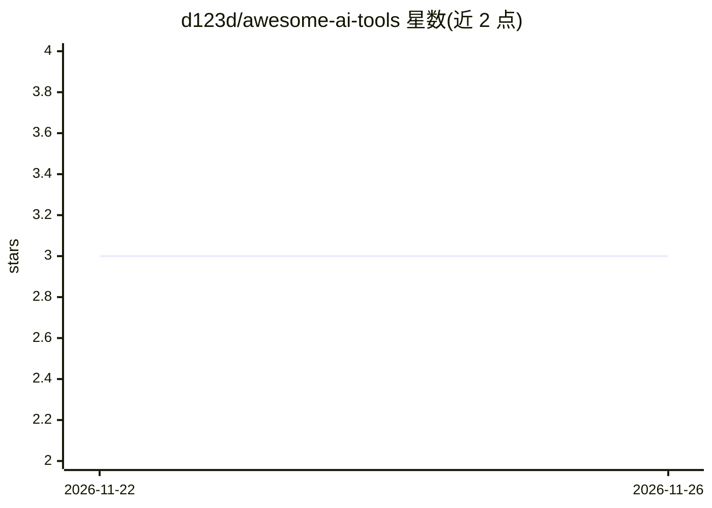

# d123d/awesome-ai-tools

⭐ 3 · Python · NOASSERTION · 推送 2026-11-21 · [GitHub](https://github.com/d123d/awesome-ai-tools) · 个人维护

**作者自用 AI 工具策展清单与全部 297 个 GitHub star 收录**

维护者以'自己实际使用并 star 的 AI 工具'为收录标准的清单：一部分为按职能分组的日常工具栈（TOOLS.md 详单），另一部分经 GitHub API 实时拉取的 297 个公开 star 仓库（9 个分区，不做人工筛选）。覆盖 agent harness、编码 agent、技能与 MCP 服务器、本地模型推理、ComfyUI 媒体管线、3D/世界生成、语音与自动化。CI 每周检查链接有效性；清单本体以 CC0 许可发布，收录条目各自保留原许可。

## 筛选速览

| 维度 | 判定 | 备注 |
|---|---|---|
| AI 角色 | `ai-knowledge` | 知识聚合/清单类 |
| 许可风险 | `none` | NOASSERTION |
| 部署形态 | `self-host` | docker 或自建部署 |
| 模型依赖 | — | README 未给出锁定关系 |
| 硬件要求 | — | 无带数字的原话,不猜 |
| 安装摩擦 | `low` | 无编译、无系统依赖或容器化 |
| 成熟度 | — | 结构信号不足 |

## 能力要点

- 两部分结构：自用工具栈 + 297 个 star 仓库全量收录（GitHub API 拉取）
- 420+ 条目、34 个自定义技能、58 个系统技能、30+ 连接器，链接由 CI 每周校验
- 分区覆盖 agent/编码、MCP、本地推理、ComfyUI 视频/图像、3D 与世界生成、语音、自动化
- 清单本体 CC0 许可，附机器可读 data/starred.json

## 适用场景

- 寻找 agent harness、编码 agent 与 MCP 服务器等方向的工具候选
- 浏览他人实际使用的本地模型与 ComfyUI 媒体工作流组合
- 按分区检索 3D/世界生成与语音方向的 star 仓库

## 场景标签

`精选清单` · 领域:学习与行业

## 证据(README 行号)

> L1: # Awesome AI Tools Awesome
> L7: A curated handout of **the AI tools we actually use and star** — agent harnesses, coding agents, skills and MCP serv
> L12: 2. **Starred by d123d** — every GitHub repo d123d has starred — **297 public repos** as of Nov 19, 2026 (1 private 

## 星数曲线

2026-11-22 3 → 2026-11-26 3（+0）

---
*卡片 v1 · prompt 1.4 · 生成 2026-11-22 · 置信度 mid · 依据 README sha `07267fb90d64` · [字段定义](../../DATASET.md)*
