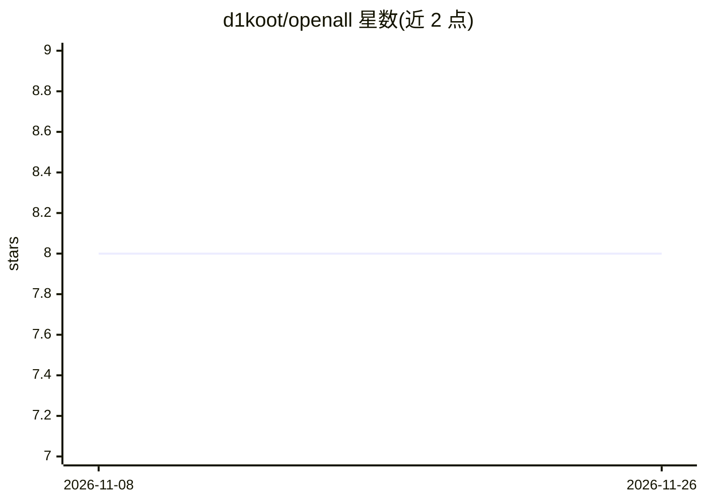

# d1koot/openall

⭐ 8 · Python · MIT · 推送 2026-11-03 · [GitHub](https://github.com/d1koot/openall) · 个人维护

**用 Claude 辅助逆向 Windows x64 程序并汇编成册的工具**

面向 Windows x64 exe/dll 的静态研究工作流：脚本先行生成函数列表、调用图、字符串、导入、vtable 等事实架层（无模型参与），再由 Claude 为每个自有函数写带证据标签（[O]/[I]/[D]/[G]）的解释页，检查器校验每条论断有出处后渲染成书。仅在四个自写小程序上测试过，仅支持 MinGW-w64 GCC 构建、仅静态分析、按编译器构建参考集，成本随未识别库代码增加。

## 筛选速览

| 维度 | 判定 | 备注 |
|---|---|---|
| AI 角色 | `ai-native` | 本体是模型或模型工具 |
| 许可风险 | `permissive` | MIT |
| 部署形态 | `desktop` | 安装包/桌面程序 |
| 模型依赖 | locked-api |  |
| 硬件要求 | — | 无带数字的原话,不猜 |
| 安装摩擦 | `medium` | 含编译或系统依赖之一 |
| 成熟度 | `idea` | |

## 能力要点

- 脚本生成的事实架层无模型参与，不猜测
- 每条论断带出处标签，检查器校验引用有效性
- 参考集（同编译器哈希）识别编译器/库代码
- 离线 pip 安装与进度续跑（progress.zip）支持

## 适用场景

- 研究自己编译的 Windows 程序的函数行为
- 在 Claude Code 会话中批量产出带出处标注的逆向笔记
- 对无符号剥离的二进制区分自有代码与库代码

## 场景标签

 · 领域:安全/逆向工程工具

## 证据(README 行号)

> L3: **Study a compiled Windows program with Claude: facts on shelves first, meaning second, nothing unchecked.**
> L13: 1. **Shelves 0-2 (facts, by scripts):** `scripts/build_shelves.py` lists the functions, the call graph, strings,
> L17: 2. **Shelf 3 (meaning, by Claude):** one short page per own function, written bottom-up from a task packet. Every

## 星数曲线

2026-11-08 8 → 2026-11-26 8（+0）

---
*卡片 v1 · prompt 1.4 · 生成 2026-11-20 · 置信度 mid · 依据 README sha `a8d254fda202` · [字段定义](../../DATASET.md)*
