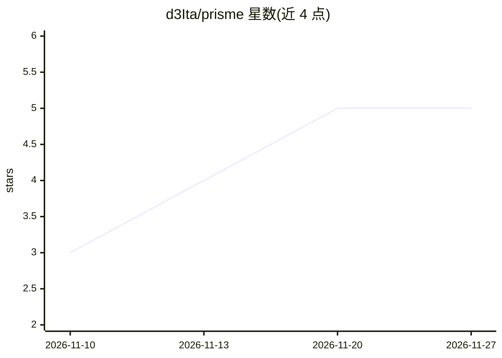

# d3Ita/prisme

⭐ 5 · Python · MIT · 推送 2026-11-16 · [GitHub](https://github.com/d3Ita/prisme) · [官网](https://d3ita.github.io/prisme/) · 个人维护 · 中文 README

**本地 AI 图像生成与编辑桌面应用，免云免 Python**

面向 Windows/macOS/Linux 的桌面图像生成工具：通过 stable-diffusion.cpp 引擎在本地 GPU 上从文本生成、编辑图像，支持提示词增强（本地 LLM）、Real-ESRGAN 4 倍放大、LoRA 管理、角色一致性、Webtoon 条漫导出。应用内一键下载引擎与模型（SHA-256 校验），首次联网后可完全离线运行。提供手机同 Wi-Fi 访问和 Claude MCP 接口。Windows 未签名需绕过 SmartScreen，macOS 未公证需手动放行。

## 筛选速览

| 维度 | 判定 | 备注 |
|---|---|---|
| AI 角色 | `ai-native` | 本体是模型或模型工具 |
| 许可风险 | `permissive` | MIT |
| 部署形态 | `desktop` | 安装包/桌面程序 |
| 模型依赖 | local-ok | 支持本地模型 |
| 硬件要求 | — | 无带数字的原话,不猜 |
| 安装摩擦 | `medium` | 含编译或系统依赖之一 |
| 成熟度 | — | 结构信号不足 |

## 能力要点

- stable-diffusion.cpp 引擎本地生成/编辑图像，支持 CUDA/Metal/Vulkan
- 本地 LLM 提示词增强与编辑指令精确化
- 应用内一键下载引擎与推荐模型，SHA-256 校验
- 手机同局域网访问及 Claude (MCP) 集成

## 适用场景

- 在本地 GPU 上私密生成和编辑图像，不上传云端
- 不想配置 Python 和节点编辑器的入门用户
- 多台手机共用一台 PC 显卡的家庭/小团队
- 用同一角色连贯生成 webtoon/漫画页面

## 场景标签

`图像生成` `图像视频处理` · 领域:内容生成

## 证据(README 行号)

> L5:  A free, open-source local AI image generator for Windows, macOS and Linux.
> L16:  stable-diffusion.cpp engine
> L39: Most local image tools ask you to install Python, manage dependencies, or wire nodes together. Prisme is a desktop 

## 星数曲线

2026-11-10 3 → 2026-11-27 5（+2）

---
*卡片 v1 · prompt 1.4 · 生成 2026-11-21 · 置信度 mid · 依据 README sha `ddaf951d4bf7` · [字段定义](../../DATASET.md)*
