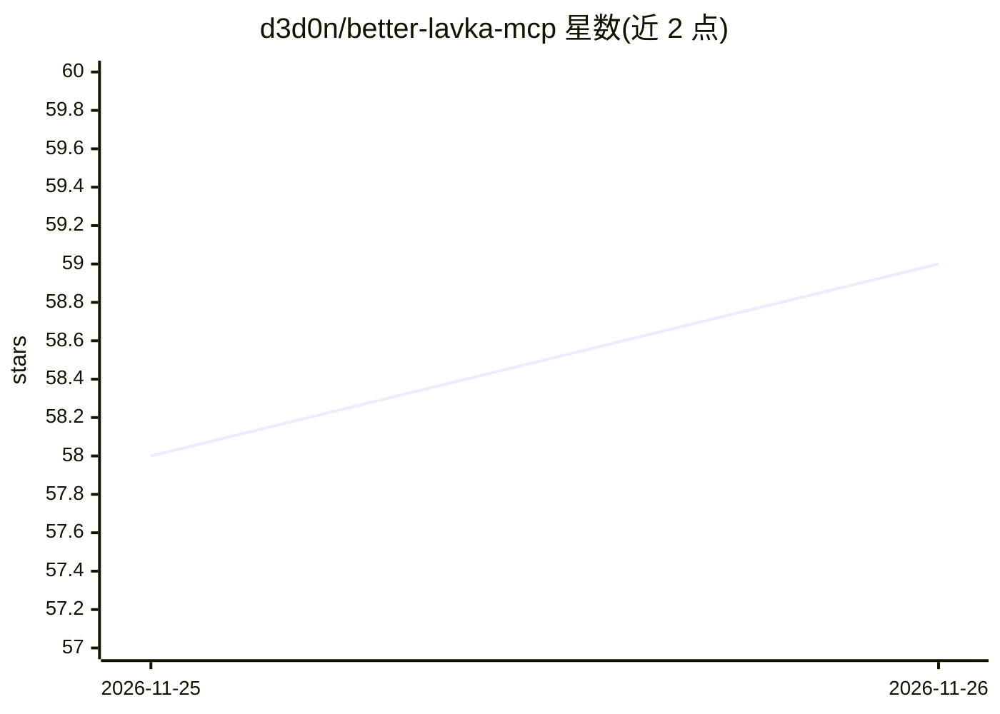

# d3d0n/better-lavka-mcp

⭐ 59 · Python · GPL-3.0 · 推送 2026-11-24 · [GitHub](https://github.com/d3d0n/better-lavka-mcp) · [官网](https://pypi.org/project/better-lavka-mcp/) · 个人维护

**让 AI 助手代为下单 Yandex Lavka 乌兹别克斯坦生鲜的 MCP 服务器**

一个 MCP 服务器，将乌兹别克斯坦 Yandex Lavka 的网页 API 封装为 26 个工具，接入 Claude、Codex、OpenCode 等 MCP 客户端后，助手可代用户搜索商品、浏览分类、填充购物车、重复上次订单并下单支付（含 3-D Secure 链接处理）。用户通过 Yandex App 扫 QR 码登录一次，全部运行在本地机器。限制：非官方，依赖未公开 API，不支持俄罗斯和哈萨克斯坦站点下单、订单实时跟踪与预约配送时段。

## 筛选速览

| 维度 | 判定 | 备注 |
|---|---|---|
| AI 角色 | `ai-ecosystem` | LLM/agent 周边工具 |
| 许可风险 | `viral` | GPL-3.0 |
| 部署形态 | `library` | 以包/库形式分发 |
| 模型依赖 | — | README 未给出锁定关系 |
| 硬件要求 | — | 无带数字的原话,不猜 |
| 安装摩擦 | `low` | 无编译、无系统依赖或容器化 |
| 成熟度 | — | 结构信号不足 |

## 能力要点

- 26 个动词+名词命名的 MCP 工具，覆盖搜索/购物车/订单/支付全流程
- QR 码一次性登录，地址与银行卡可被记住
- 商品与订单以三词短 id 表示（约 5 token），同一商品 id 稳定
- 工具输出默认短文本并提示助手下一步操作，可切换为原始 JSON

## 适用场景

- 对 AI 助手说一句话补齐购物清单并下单
- 粘贴菜谱让助手自动凑齐食材入购物车
- 查询门店商品价格与营养标签
- 让助手复述/取消上次订单

## 场景标签

`AI 助手` · 领域:对话与助手

## 证据(README 行号)

> L22: An MCP server for Yandex Lavka in Uzbekistan. Connect it to Claude, Codex, OpenCode or any other MCP client, and yo
> L93: Twenty-six tools with plain verb + noun names, so the assistant picks the right one on the first try.
> L151:  Unofficial · runs on your machine · GPL-3.0-only

## 星数曲线

2026-11-25 58 → 2026-11-26 59（+1）

---
*卡片 v1 · prompt 1.4 · 生成 2026-11-24 · 置信度 high · 依据 README sha `92b681a9e986` · [字段定义](../../DATASET.md)*
