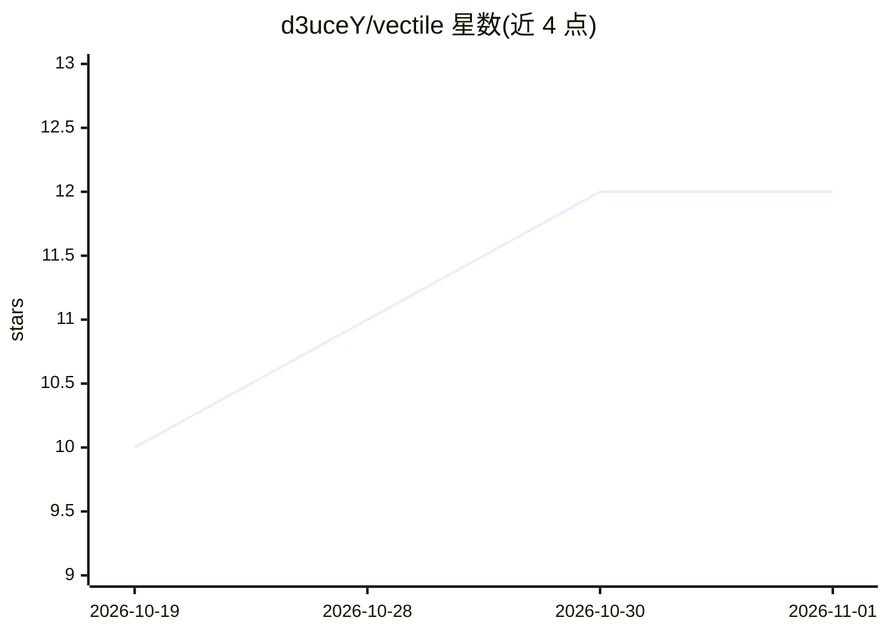

# d3uceY/vectile

⭐ 12 · Go · Apache-2.0 · 推送 2026-10-26 · [GitHub](https://github.com/d3uceY/vectile) · 个人维护

**本地混合检索的桌面知识库搜索应用，索引笔记/书籍/代码**

面向个人用户的桌面端本地 RAG 应用（Windows/macOS/Linux）：将 Obsidian 库、文档目录、Calibre 书库和代码仓库（含提交历史）索引进单个 SQLite 库，用向量+全文双路检索并以 Reciprocal Rank Fusion 融合，支持按语义而非精确词查找。嵌入模型以 .gguf 在进程内经 llama.cpp 运行，无需 Ollama 或 API key；索引、解析、嵌入、搜索、OCR 全部本地执行，仅三类明确的外发请求。内置 MCP 服务器（默认关闭、仅回环）可把搜索/读取工具暴露给 Claude Desktop 等本地客户端。提供各平台安装包与源码构建两种途径，未代码签名。

## 筛选速览

| 维度 | 判定 | 备注 |
|---|---|---|
| AI 角色 | `ai-native` | 本体是模型或模型工具 |
| 许可风险 | `permissive` | Apache-2.0 |
| 部署形态 | `desktop` | 安装包/桌面程序 |
| 模型依赖 | local-ok | 支持本地模型 |
| 硬件要求 | — | 无带数字的原话,不猜 |
| 安装摩擦 | `low` | 无编译、无系统依赖或容器化 |
| 成熟度 | — | 结构信号不足 |

## 能力要点

- 向量+FTS5 全文双路检索，Reciprocal Rank Fusion 融合排序
- .gguf 嵌入模型进程内运行（基于 llama.cpp），无需 Ollama 与 API key
- 支持 Obsidian/文档/Calibre/代码仓库，tree-sitter 按函数/类切块并索引提交历史
- 本地 MCP 服务器（127.0.0.1）向 Claude 等客户端暴露搜索与读取工具

## 适用场景

- 把散落在 Obsidian、Calibre 和代码仓库里的资料统一成一个可语义搜索的库
- 让 Claude Desktop 等 MCP 客户端检索和读取我的本地资料库
- 离线私有环境下按含义（而非精确关键词）查找笔记与文档

## 场景标签

`知识库管理` `语义搜索` · 领域:知识与检索

## 证据(README 行号)

> L3: A local RAG (Retrieval Augmented Generation) app for Windows, macOS, and Linux. It indexes your notes, books, and co
> L13: - **Private:** indexing, parsing, embedding, search, and OCR run inside the app. Your documents and their text are 
> L19: - **MCP server:** expose search, read, and collection tools to any local MCP client.

## 星数曲线

2026-10-19 10 → 2026-11-01 12（+2）

---
*卡片 v1 · prompt 1.4 · 生成 2026-11-01 · 置信度 high · 依据 README sha `04f014b258f2` · [字段定义](../../DATASET.md)*
