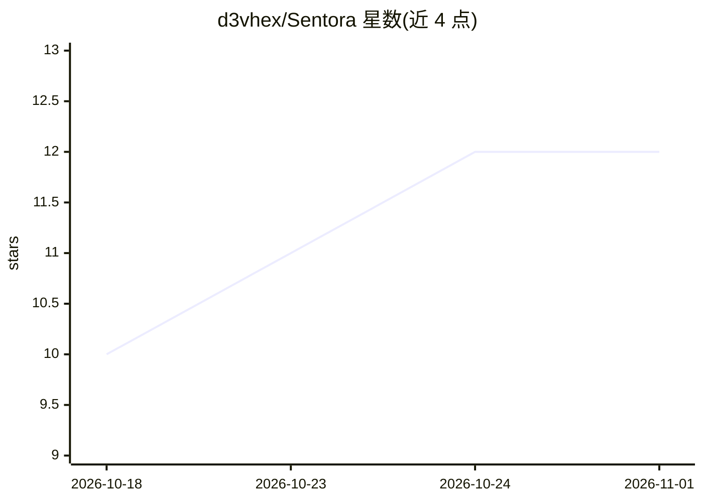

# d3vhex/Sentora

⭐ 12 · Python · AGPL-3.0 · 推送 2026-09-20 · [GitHub](https://github.com/d3vhex/Sentora) · 个人维护

**自托管一体化 SIEM/EDR/SOAR 平台，内置本地 LLM 告警分诊**

面向没有专职 SOC 的小中型团队的自托管安全运维平台：在终端部署 agent，通过单条 TCP 通道采集 SIEM 日志、文件完整性、软件包漏洞、网络连接等遥测；端上以 Sigma 规则（43 条内置、覆盖 51 项 MITRE ATT&CK 技术）做确定性检测并跨事件关联识别口令喷洒/暴破等，数据入 OpenSearch 供检索。AI 部分为本地 Ollama 模型（默认 llama3.2:3b）驱动的三个并行 worker：实时事件分诊、手动深度扫描、防御动作决策（支持 shadow mode 人工审批与安全动作白名单）。日志不外传、无外部 API key。整体以 docker compose 一键拉起，含 SOAR 剧本引擎与内置远程桌面。

## 筛选速览

| 维度 | 判定 | 备注 |
|---|---|---|
| AI 角色 | `ai-enhanced` | 去掉 AI 部分产品仍成立 |
| 许可风险 | `viral` | AGPL-3.0 |
| 部署形态 | `desktop` | 安装包/桌面程序 |
| 模型依赖 | local-ok | 支持本地模型 |
| 硬件要求 | — | 无带数字的原话,不猜 |
| 安装摩擦 | `low` | 无编译、无系统依赖或容器化 |
| 成熟度 | — | 结构信号不足 |

## 能力要点

- Windows/Linux agent 单 TCP 通道采集遥测，OpenSearch 统一日志检索
- Sigma 规则端上检测 + 跨事件/跨主机关联，确定性层在模型不可用时仍工作
- 本地 Ollama LLM 三个 worker：实时分诊、深度扫描、防御动作（含 shadow mode 与动作白名单）
- SOAR 可视化剧本引擎、OSV 包漏洞扫描、abuse.ch 威胁情报拉取

## 适用场景

- 没有专职 SOC 的小团队自建日志采集与告警检测平台
- 让本地 LLM 对告警做分诊并在审批后执行封禁 IP/隔离主机等响应
- 跨多台主机的口令喷洒等低噪声攻击的关联检测

## 场景标签

`网络安全` · 领域:学习与行业

## 证据(README 行号)

> L7: Self-hosted security stack for small/mid teams that don't have a dedicated
> L33:  working when the model is unavailable.
> L56: - **Triages every event with a local LLM.** Three workers run in parallel:

## 星数曲线

2026-10-18 10 → 2026-11-01 12（+2）

---
*卡片 v1 · prompt 1.4 · 生成 2026-11-01 · 置信度 high · 依据 README sha `37e76927fc1c` · [字段定义](../../DATASET.md)*
