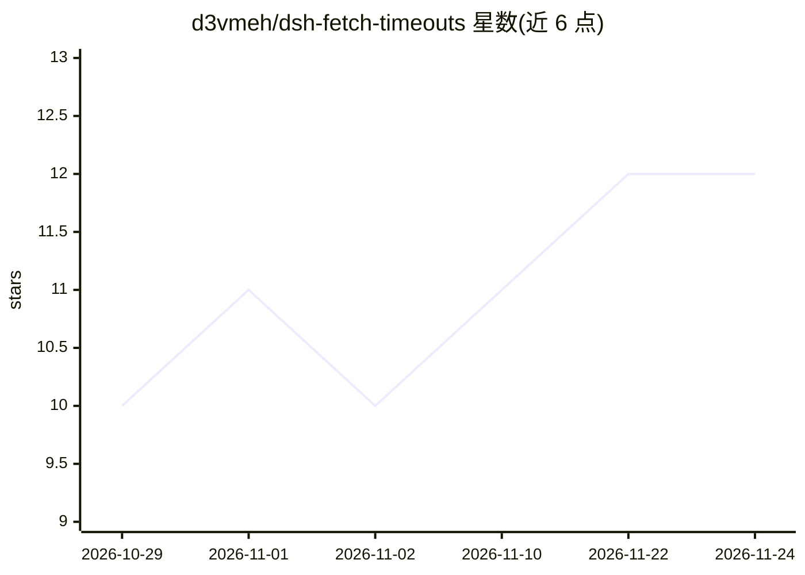

# d3vmeh/dsh-fetch-timeouts

⭐ 12 · JavaScript · MIT · 推送 2026-10-04 · [GitHub](https://github.com/d3vmeh/dsh-fetch-timeouts) · 个人维护

**DeepSeek Harness 插件：提高 Node HTTP 超时避免慢速本地模型被切断**

面向 DeepSeek Harness（dsh）的插件，通过包裹 Node 全局 fetch dispatcher 进程级提升 headers/body 超时（默认 30 分钟），解决 Ollama、LM Studio 等本地模型长时间无响应时在 300 秒被 undici 切断的问题。通过 dsh plugin 命令安装，可在 cordis.patch.yml 中自定义超时毫秒数；作用于所有使用全局 dispatcher 的请求（模型调用、web 搜索、HTTP MCP、云端 provider），卸载时恢复原 dispatcher。作者自称属权宜方案，待 dsh 原生暴露这些超时后即无必要。

## 筛选速览

| 维度 | 判定 | 备注 |
|---|---|---|
| AI 角色 | `ai-ecosystem` | LLM/agent 周边工具 |
| 许可风险 | `permissive` | MIT |
| 部署形态 | `None` |  |
| 模型依赖 | local-ok | 支持本地模型 |
| 硬件要求 | — | 无带数字的原话,不猜 |
| 安装摩擦 | `low` | 无编译、无系统依赖或容器化 |
| 成熟度 | `idea` | |

## 能力要点

- 进程级提升 Node fetch 的 headers/body 超时，默认 30 分钟
- 通过包裹全局 dispatcher 实现，保留既有路由与 dsh 0.2 代理规则
- 可在 cordis.patch.yml 中按毫秒自定义超时（0 为禁用）
- 卸载插件可恢复被包裹的原 dispatcher

## 适用场景

- 本地 Ollama 生成大型工具调用时避免 5 分钟被切断
- 配合 LM Studio 等不发送 keepalive 的后端使用
- 单用户机器上运行 dsh web 长时间推理任务

## 场景标签

 · 领域:LLM 基础设施/推理接入工具

## 证据(README 行号)

> L3: Raises Node's HTTP timeouts for the whole DeepSeek Harness process, so a slow local model is not cut off after 5 min
> L9: Servers that stay silent that long include Ollama and LM Studio while a model thinks or generates a large tool call 

## 星数曲线

2026-10-29 10 → 2026-11-24 12（+2）

---
*卡片 v1 · prompt 1.4 · 生成 2026-11-18 · 置信度 high · 依据 README sha `307875d35e09` · [字段定义](../../DATASET.md)*
