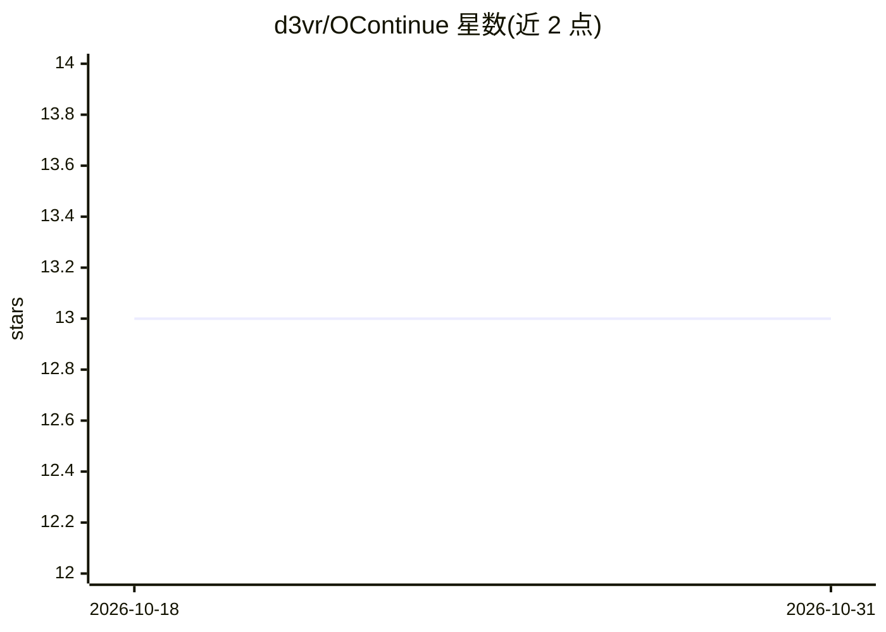

# d3vr/OContinue

⭐ 13 · TypeScript · MIT · 推送 2025-12-30 · [GitHub](https://github.com/d3vr/OContinue) · 个人维护

**OpenCode 插件：重复投喂同一提示直到 AI 宣告任务完成**

为 OpenCode 实现自纠错 AI 循环的插件：监听 session.idle 事件，检查 AI 是否输出完成信号（默认 <promise>DONE</promise>），未完成则通过 SDK 再次发送同一提示，AI 在上下文中看到先前工作并继续，直至完成或达到最大迭代（默认 20）。受 Geoffrey Huntley 的 Ralph 技术启发，机制差异在于用空闲事件触发续跑而非退出钩子。支持每会话独立循环、中断检测、状态跨重启持久化与日志。以复制 plugin/command 目录方式安装。

## 筛选速览

| 维度 | 判定 | 备注 |
|---|---|---|
| AI 角色 | `ai-ecosystem` | LLM/agent 周边工具 |
| 许可风险 | `permissive` | MIT |
| 部署形态 | `None` |  |
| 模型依赖 | — | README 未给出锁定关系 |
| 硬件要求 | — | 无带数字的原话,不猜 |
| 安装摩擦 | `low` | 无编译、无系统依赖或容器化 |
| 成熟度 | — | 结构信号不足 |

## 能力要点

- session.idle 事件触发的同提示重投循环（默认最多 20 次迭代）
- 自定义完成信号文本与最大迭代数
- 循环状态跨 OpenCode 重启持久化
- 支持多会话并行循环与 Esc/Ctrl+C 中止检测

## 适用场景

- 让 AI 持续修复 TypeScript 报错直到清零
- 大型重构任务跨多轮上下文自动续跑
- 无人值守的长任务循环执行

## 场景标签

`编码 Agent` · 领域:编码与开发

## 证据(README 行号)

> L3: A plugin for OpenCode that implements a self-referential AI loop - repeatedly feeding the same prompt until the AI s
> L82: |Mechanism|Stop hook blocks exit|session.idle event triggers continuation|

## 星数曲线

2026-10-18 13 → 2026-10-31 13（+0）

---
*卡片 v1 · prompt 1.4 · 生成 2026-10-31 · 置信度 high · 依据 README sha `752eea2ba24c` · [字段定义](../../DATASET.md)*
