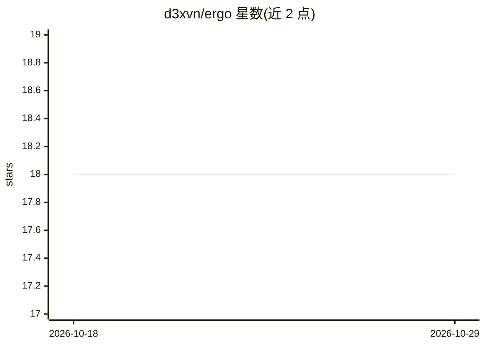

# d3xvn/ergo

⭐ 18 · Dart · MIT · 推送 2026-03-14 · [GitHub](https://github.com/d3xvn/ergo) · 个人维护

**面向 Lean 4 形式化证明的 AI 辅助 IDE（Flutter 构建）**

用 Flutter 构建的跨平台 Lean 4 定理证明 IDE，通过 LSP 连接 Lean 语言服务器，提供语法高亮、Unicode 输入、实时证明目标（Infoview）、行内诊断、文件树与标签页编辑器。AI 部分集成 Claude 智能体（需自行设置 API key）：可读写文件、查看证明状态与诊断，自动应用编辑并支持撤销，另集成 Loogle/Moogle 引理搜索。构建层面封装 lake build/update/clean 与 Mathlib 缓存命令，可在应用内一键安装 elan 工具链。不配置 Claude API key 时编辑器与 LSP 功能仍可用。

## 筛选速览

| 维度 | 判定 | 备注 |
|---|---|---|
| AI 角色 | `ai-enhanced` | 去掉 AI 部分产品仍成立 |
| 许可风险 | `permissive` | MIT |
| 部署形态 | `None` |  |
| 模型依赖 | locked-api |  |
| 硬件要求 | — | 无带数字的原话,不猜 |
| 安装摩擦 | `low` | 无编译、无系统依赖或容器化 |
| 成熟度 | — | 结构信号不足 |

## 能力要点

- Lean 4 LSP 集成：实时证明目标、诊断、悬停类型信息
- Claude 智能体带完整工具调用，可感知证明状态并自动写文件（可撤销）
- 集成 Loogle 类型搜索与 Moogle 自然语言引理搜索
- 应用内一键安装 elan 工具链，封装 lake build/update/clean 与 Mathlib 缓存

## 适用场景

- 在专用 IDE 中编写 Lean 4 形式化证明并实时查看证明目标
- 让 AI 智能体读取证明状态、搜索引理并直接编辑证明代码
- 管理 Lean 项目的构建、依赖更新与 Mathlib 缓存

## 场景标签

`编码 Agent` · 领域:编码与开发

## 证据(README 行号)

> L5:  A Cursor for Mathematics — an AI-powered IDE for Lean 4 theorem proving.
> L68: 3. Set your **Claude API key** via `⌘,` or the Edit menu
> L100: - **Anthropic Claude API** — LLM agent with tool use for code editing and proof assistance

## 星数曲线

2026-10-18 18 → 2026-10-29 18（+0）

---
*卡片 v1 · prompt 1.4 · 生成 2026-10-29 · 置信度 mid · 依据 README sha `1589e5b7c4c6` · [字段定义](../../DATASET.md)*
