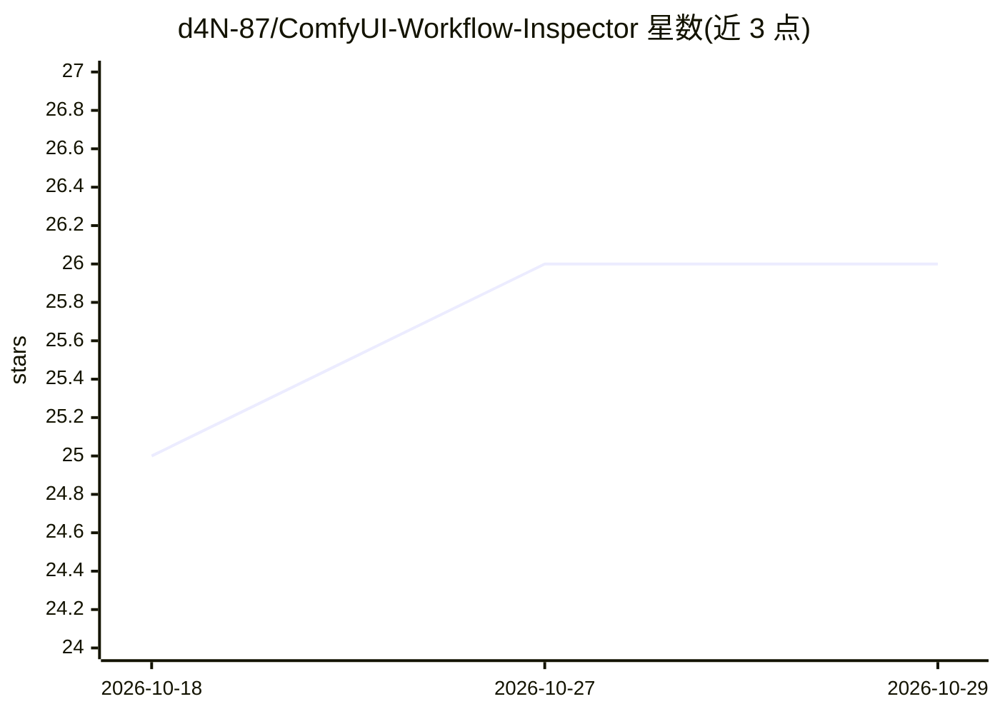

# d4N-87/ComfyUI-Workflow-Inspector

⭐ 26 · TypeScript · MIT · 推送 2026-10-19 · [GitHub](https://github.com/d4N-87/ComfyUI-Workflow-Inspector) · [官网](https://d4n-87.github.io/ComfyUI-Workflow-Inspector/) · 个人维护

**浏览器端查看 ComfyUI 工作流元数据的 React 检视工具**

基于 React/Vite/TypeScript 的 Web 应用，读取嵌入在 PNG、WebP、MP3、MP4、FLAC 及 JSON 文件中的 ComfyUI 工作流元数据，展示节点列表、处理参数与笔记，并用 LiteGraph.js 渲染可交互的工作流图（节点可移动、折叠）。全部解析在浏览器本地完成，不上传文件。界面提供意/英/法/德/西五种语言，并托管在线 Demo。限制：自定义节点不在标准 object_info.json 中时可能显示为通用节点或错误指示。

## 筛选速览

| 维度 | 判定 | 备注 |
|---|---|---|
| AI 角色 | `ai-ecosystem` | LLM/agent 周边工具 |
| 许可风险 | `permissive` | MIT |
| 部署形态 | `library` | 以包/库形式分发 |
| 模型依赖 | — | README 未给出锁定关系 |
| 硬件要求 | — | 无带数字的原话,不猜 |
| 安装摩擦 | `low` | 无编译、无系统依赖或容器化 |
| 成熟度 | — | 结构信号不足 |

## 能力要点

- 支持从 PNG/WebP/MP4/FLAC/JSON 提取 ComfyUI 工作流元数据
- LiteGraph.js 交互式图渲染，节点可移动、折叠/展开
- 纯客户端运行，文件不上传外部服务器
- 五种界面语言（IT/EN/FR/DE/ES）

## 适用场景

- 查看他人分享的 ComfyUI 生图文件里藏着什么工作流
- 在浏览器里复现工作流结构，含节点参数（seed/steps/cfg/sampler）
- 不想安装 ComfyUI 时快速检视工作流连接结构

## 场景标签

 · 领域:开发者工具/AIGC 工作流检视

## 证据(README 行号)

> L13: **Inspect and visualize ComfyUI workflow metadata embedded in PNG, WebP, MP4, FLAC, and JSON files with an intuitiv
> L23: * 🇮🇹 **Rendering Grafo Interattivo**: Grafo renderizzato con LiteGraph.js, con i widget dei nodi (seed, steps, cfg,

## 星数曲线

2026-10-18 25 → 2026-10-29 26（+1）

---
*卡片 v1 · prompt 1.4 · 生成 2026-10-27 · 置信度 high · 依据 README sha `21b4486cab81` · [字段定义](../../DATASET.md)*
