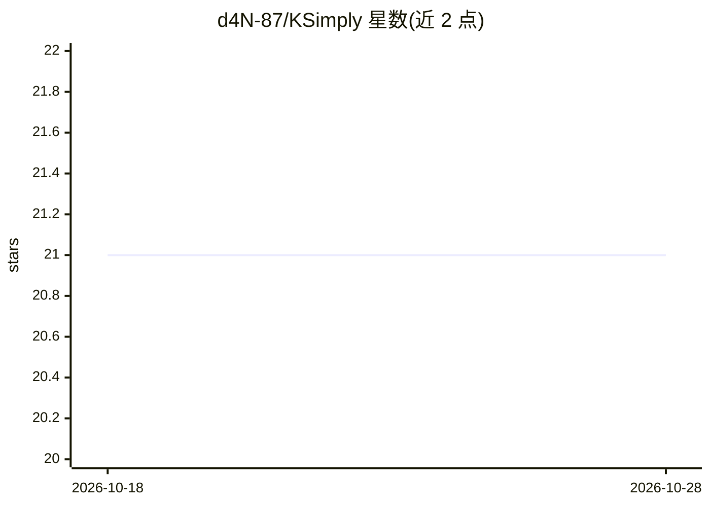

# d4N-87/KSimply

⭐ 21 · TypeScript · MIT · 推送 2026-06-02 · [GitHub](https://github.com/d4N-87/KSimply) · [官网](https://ksimply.vercel.app) · 个人维护

**按用户硬件推荐可运行开源 AI 模型的 Web 应用**

面向生成式 AI 新手的 Web 应用：用户输入 GPU 与系统 RAM，应用查询策展的开源模型数据库，用分析引擎模拟每种模型“配方”（基础模型、FP16/FP8/GGUF 量化、Text Encoder 与 VAE 等组件组合）的内存占用，评估 VRAM 是否容纳全部组件、是否可 offload 到系统 RAM 并提示性能影响。技术栈为 SvelteKit/TypeScript/SQLite(本地)/Turso(生产)/Vercel，本地运行需 Node.js 18+，经 git clone、npm install、数据库 seed 后启动。数据库将定期更新新显卡与模型。

## 筛选速览

| 维度 | 判定 | 备注 |
|---|---|---|
| AI 角色 | `ai-ecosystem` | LLM/agent 周边工具 |
| 许可风险 | `permissive` | MIT |
| 部署形态 | `library` | 以包/库形式分发 |
| 模型依赖 | — | README 未给出锁定关系 |
| 硬件要求 | — | 无带数字的原话,不猜 |
| 安装摩擦 | `low` | 无编译、无系统依赖或容器化 |
| 成熟度 | — | 结构信号不足 |

## 能力要点

- 基于 GPU 与 RAM 输入查询策展模型数据库给出推荐
- 模拟所有模型配方的内存负载，覆盖 FP16/FP8/GGUF 量化
- 评估 VRAM 全驻留、RAM offload 可行性及系统需求
- 双语（意/英）SvelteKit Web 应用，本地 SQLite 与生产 Turso 数据库

## 适用场景

- 我想知道自己的 GPU 和内存能跑哪些开源模型
- 比较不同量化格式下模型的内存占用与可行性
- 了解模型组件 offload 到 RAM 后是否还能运行

## 场景标签

 · 领域:AI 模型选型/硬件适配

## 证据(README 行号)

> L28: 🇬🇧 KSimply is a web application designed to answer a simple but crucial question for newcomers to generative AI: **
> L30: The user inputs their GPU and system RAM, and KSimply queries a curated database of AI models to provide a list of 

## 星数曲线

2026-10-18 21 → 2026-10-28 21（+0）

---
*卡片 v1 · prompt 1.4 · 生成 2026-10-28 · 置信度 high · 依据 README sha `a457ac32499c` · [字段定义](../../DATASET.md)*
