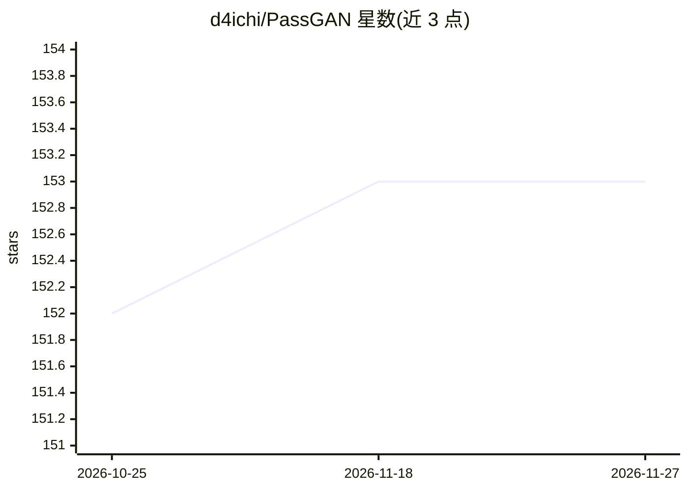

# d4ichi/PassGAN

⭐ 153 · Python · MIT · 推送 2026-11-24 · [GitHub](https://github.com/d4ichi/PassGAN) · 个人维护

**用 GAN 生成密码样本的 PassGAN 更新版，供安全研究使用**

论文 PassGAN: A Deep Learning Approach for Password Guessing 的代码更新版，适配 Python 3.12 与 TensorFlow 2（经 tf.compat.v1）。提供 sample.py 与 train.py 命令行工具、在 RockYou 数据集上预训练的模型，以及调试用 Jupyter notebook。采样与训练在 CPU 上即可运行，GPU 环境下自动分配可用设备；环境依赖版本已固定，附带验证测试检查生成器张量与已保存图的一致性。

## 筛选速览

| 维度 | 判定 | 备注 |
|---|---|---|
| AI 角色 | `ai-native` | 本体是模型或模型工具 |
| 许可风险 | `permissive` | MIT |
| 部署形态 | `desktop` | 安装包/桌面程序 |
| 模型依赖 | — | README 未给出锁定关系 |
| 硬件要求 | — | 无带数字的原话,不猜 |
| 安装摩擦 | `medium` | 含编译或系统依赖之一 |
| 成熟度 | — | 结构信号不足 |

## 能力要点

- 提供在 RockYou 数据集上预训练的模型，可直接生成 100 万条密码样本
- 训练与采样支持 Python 3.12 / TensorFlow 2，CPU 可运行，GPU 自动分配
- 内置验证测试：核对 24 个生成器张量并与保存的 .meta 图对比输出
- 保留原版训练参数与输出布局（字符字典/检查点/预览样本）

## 适用场景

- 用预训练模型生成密码样本研究密码猜测
- 在自己的密码泄露数据集上训练自定义模型
- 运行 notebook 逐步调试采样与训练流程

## 场景标签

`网络安全` `模型训练` · 领域:学习与行业

## 证据(README 行号)

> L3: This repository is an updated version of @brannondorsey/PassGAN. It contains code for the _PassGAN: A Deep Learning 
> L34: Use the pretrained model to generate 1,000,000 passwords, saving them to `generated_pass.txt`.

## 星数曲线

2026-10-25 152 → 2026-11-27 153（+1）

---
*卡片 v1 · prompt 1.4 · 生成 2026-11-27 · 置信度 high · 依据 README sha `e713a01e6ac2` · [字段定义](../../DATASET.md)*
