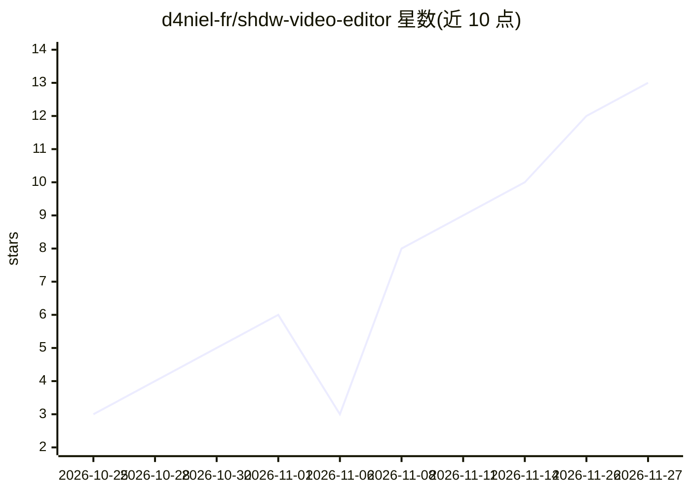

# d4niel-fr/shdw-video-editor

⭐ 13 · TypeScript · AGPL-3.0 · 推送 2026-10-16 · [GitHub](https://github.com/d4niel-fr/shdw-video-editor) · [官网](https://github.com/d4niel-fr/shdw-video-editor/releases/latest) · 个人维护

**开发者/创作者的开源 AI 视频编辑器：agent 写代码做动效**

桌面视频编辑器，界面按六个页面组织（Media/Edit/Motion/Color/Fairlight/Deliver），内置 Claude Code 或 Codex agent，以 HTML/GSAP 等代码文件形式生成动效并放入时间线，支持剪辑、调色、音频、Whisper 离线字幕与多种格式导出。agent 通过本地 HTTP 控制 API（127.0.0.1:47800）渲染帧与 contact sheet 自检输出。依赖 FFmpeg、Chromium 浏览器与 agent CLI；macOS 构建尚未 notarize。

## 筛选速览

| 维度 | 判定 | 备注 |
|---|---|---|
| AI 角色 | `ai-native` | 本体是模型或模型工具 |
| 许可风险 | `viral` | AGPL-3.0 |
| 部署形态 | `desktop` | 安装包/桌面程序 |
| 模型依赖 | — | README 未给出锁定关系 |
| 硬件要求 | — | 无带数字的原话,不猜 |
| 安装摩擦 | `medium` | 含编译或系统依赖之一 |
| 成熟度 | — | 结构信号不足 |

## 能力要点

- agent 将动效写成 HTML/CSS/SVG+GSAP/canvas/GLSL 代码文件，全部保留可编辑
- 内置本地控制 API：渲染帧/contact sheet、导入、转录、字幕、导出
- 支持 Whisper 离线字幕、37 GPU 特效、36 转场、LUT 调色与 ProRes/VP9 alpha 导出
- 可直接使用已安装的 Claude Code skills

## 适用场景

- 一句话生成可继续手工编辑的多场景视频
- 为产品做宣传短片、访谈竖版短视频与卡拉OK字幕
- 按品牌 skill 生成统一风格的下三分之一字幕条与图表动画

## 场景标签

`编码 Agent` `语音识别` `视频生成` · 领域:编码与开发

## 证据(README 行号)

> L7: A DaVinci Resolve-style editor — timeline, color, audio, deliver — with an AI agent built in that **writes motion gr
> L217: - **Rust (Tauri 2)** backend: FFmpeg decode/encode, file watching, a pool of headless Chromium renderers with *vir

## 星数曲线

2026-10-25 3 → 2026-11-27 13（+10）

---
*卡片 v1 · prompt 1.4 · 生成 2026-11-19 · 置信度 mid · 依据 README sha `716c8df812a2` · [字段定义](../../DATASET.md)*
