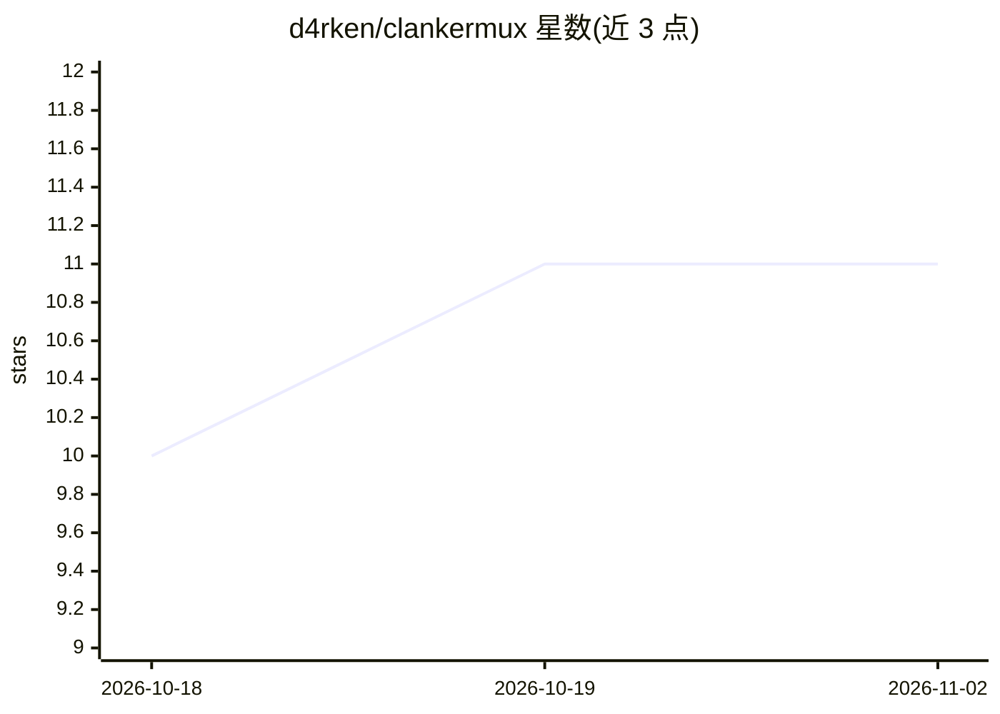

# d4rken/clankermux

⭐ 11 · TypeScript · NOASSERTION · 推送 2026-10-31 · [GitHub](https://github.com/d4rken/clankermux) · 个人维护

**自托管编码代理网关：把多个模型账号聚合到一个 API 后**

面向使用 Claude Code、Codex 等编码客户端的开发者的自托管 API 网关：客户端指向 ClankerMux 而非直接连提供商，网关按优先级选择账号，在限流或临时故障时跨账号切换，并限制各客户端可达范围。支持 Anthropic/Codex/Grok OAuth 登录、Claude 与 OpenAI API key、OpenRouter、Ollama 等接入。提供粘性会话路由、模型别名、5 小时/7 天配额池与燃耗预测、按账号与客户端过滤的统计面板。通过 git clone + Bun 从源码构建运行，需 Bun 1.4.4+。README 提示通过其他客户端使用 Claude 账号是否合规由运营者自行判断。

## 筛选速览

| 维度 | 判定 | 备注 |
|---|---|---|
| AI 角色 | `ai-ecosystem` | LLM/agent 周边工具 |
| 许可风险 | `viral` | NOASSERTION |
| 部署形态 | `None` |  |
| 模型依赖 | local-ok | 支持本地模型 |
| 硬件要求 | — | 无带数字的原话,不猜 |
| 安装摩擦 | `low` | 无编译、无系统依赖或容器化 |
| 成熟度 | `idea` | |

## 能力要点

- 优先级账号选择与跨账号故障切换（429 重试、529 熔断）
- 粘性会话路由以提升 prompt-cache 命中率
- 可复用模型别名（如 good-model）带有序回退目标
- 5 小时/7 天配额池、燃耗预测与跑道估算，统计可按账号/客户端过滤

## 适用场景

- 把多个付费模型账号聚合到统一 API 供编码客户端使用
- 在限流或账号配额耗尽时自动切换到其他账号
- 按客户端限制可访问的提供商与模型范围
- 监控各账号配额消耗与请求延迟统计

## 场景标签

`模型网关` · 领域:Agent 开发

## 证据(README 行号)

> L8: A gateway that puts the model accounts you pay for behind one API. Your coding
> L9: clients point at ClankerMux instead of a provider; it picks which account serves
> L15: * **Harnesses**: Claude Code, Codex, OpenCode, Pi Agent, Oh My Pi. Two

## 星数曲线

2026-10-18 10 → 2026-11-02 11（+1）

---
*卡片 v1 · prompt 1.4 · 生成 2026-11-02 · 置信度 high · 依据 README sha `c73c4e6da02c` · [字段定义](../../DATASET.md)*
